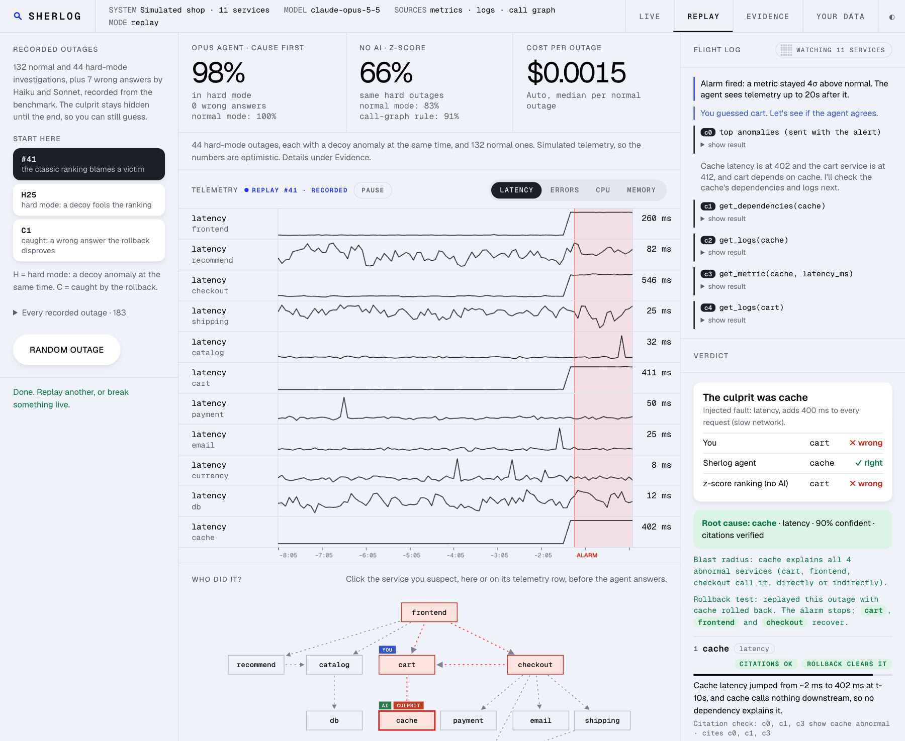
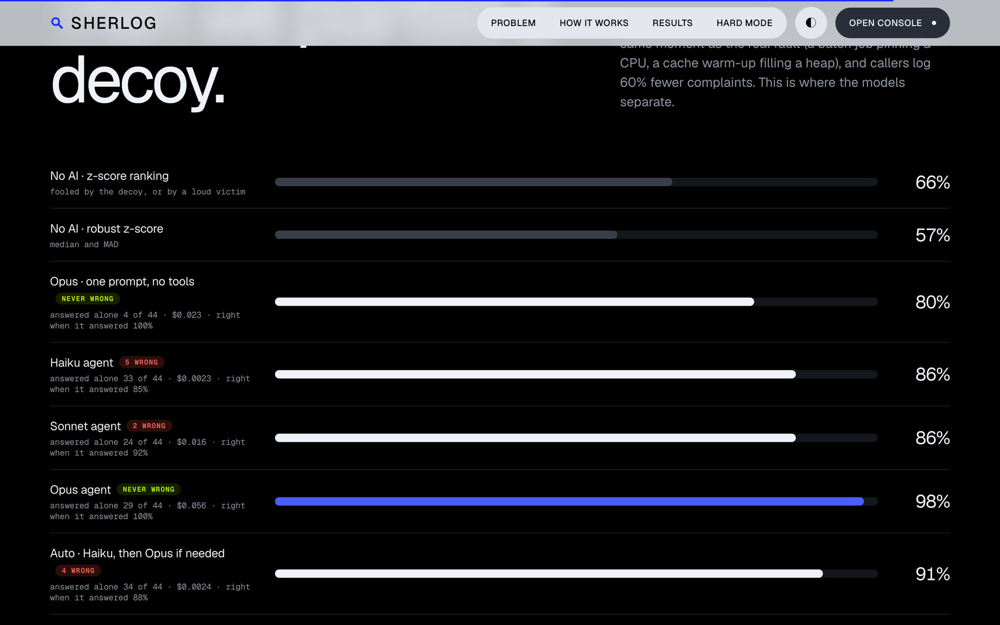

# Sherlog

**When one service breaks, everything that calls it breaks too. Sherlog is an AI on-call investigator that finds the one that broke, and has to prove it**: plain code checks every piece of evidence it cites, and a replay with its answer rolled back shows whether the outage really stops.

<p align="center"><a href="https://sherlog-jade.vercel.app"></a></p>

<p align="center">
  <a href="https://github.com/shaunmortal/sherlog/actions/workflows/tests.yml"></a>
  
  <a href="LICENSE"></a>
</p>

<p align="center">
  <a href="https://sherlog-jade.vercel.app"></a>&nbsp;&nbsp;
  <a href="https://sherlog-jade.vercel.app/console"></a>&nbsp;&nbsp;
  <a href="https://sherlog-jade.vercel.app/status"></a>
</p>

Built during IceHacks 2026.

**Contents:** [What's new](#whats-new-here) · [Try it in 30 seconds](#try-it-in-30-seconds) · [How it works](#how-it-works) · [Results](#results) · [Accessibility](#accessibility) · [Reliability](#reliability) · [Bring your own outage](#bring-your-own-outage) · [Reproduce](#reproduce) · [Layout](#repository-layout) · [Limitations](#limitations)

---

## What's new here

- **Answers must prove themselves.** Every suspect cites the tool calls (`c0`, `c1`, …) behind it, and plain code, not a second AI, checks that each cited call really showed that service abnormal. Only a verified top suspect at 80% confidence or more goes out; everything else goes to a human.
  *In hard mode the Opus agent answered 29 of 44 outages on its own, all right, and handed the other 15 to a human.*
- **Proof by intervention.** After the verdict, Sherlog replays the same outage, with the same noise, and its answer rolled back. Roll back the cause and the slowness and errors stop; roll back a victim or a decoy and they carry on, so a decoy that fools every check that only looks cannot fool this one. This is possible because the shop is simulated; in production the same idea is a canary rollback.
  *Over the recorded runs of the four single-model methods, it would have caught all 7 wrong hard-mode answers and rejected none of the 83 right ones.*
- **A hard mode where the models separate.** On normal outages every Claude variant scores 100%, which says nothing. Hard mode adds a decoy: a service the fault cannot reach, with a harmless anomaly that starts with the fault.
  *Opus named the cause first in 43 of 44 and never answered wrong; Haiku answered 5 wrong, Sonnet 2.*
- **You vs Claude vs the classic ranking.** Lock in your guess before the agent answers. The scoreboard shows who was right: you, Claude, or the standard no-AI z-score ranking.
  *The classic ranking blames a victim in 23 of 132 normal outages; the agent in none.*
- **Verifier-gated model routing.** **Auto** lets Claude Haiku go first. A fresh Opus investigation starts only when Haiku's answer fails the verifier, is under 80% sure, or another service would explain more of the outage.
  *It answered all 132 normal outages, all right, for a median $0.0015 each, calling Opus in 4.*

---

## Try it in 30 seconds

1. **Guess.** On the [story page](https://sherlog-jade.vercel.app), scroll to the wall of red and pick the service you think broke. It shows the cause and which ones were only victims.
2. **Break a service.** In the [console](https://sherlog-jade.vercel.app/console), pick a service, a fault and who investigates, press **Break it live**, then lock in your guess on the map while Claude works. Or replay [outage #41](https://sherlog-jade.vercel.app/console#replay/41) for free: the classic ranking blames `cart`, the agent names `cache`, and rolling `cache` back clears all four broken services.
3. **Bring your own outage.** In the console's **Your data** tab, press **Use the sample**, then **Triage (no AI)**. The alarm, both no-AI rankings and the blast-radius check run on it, with no API key. **Investigate with Claude** runs the agent on it.

<table>
  <tr>
    <td width="50%"></td>
    <td width="50%"></td>
  </tr>
  <tr>
    <td><em>A wall of red: pick the one that broke, then see which were victims.</em></td>
    <td><em>A pinned stage walks through the alarm, the investigation, the verifier, the verdict and the rollback.</em></td>
  </tr>
</table>

---

## How it works


1. **Detect.** The alarm fires when a metric stays 4σ above its normal level for 15 seconds. It is deliberately not AI, so what the AI adds can be measured on its own.
2. **Investigate.** The agent starts from the top anomalies and works through at most 8 rounds of read-only tools (`get_metric`, `get_logs`, `get_dependencies`), then submits up to five suspects, each with a fault type, one sentence of reasoning, a confidence and the ids of the tool calls that support it. It is never told what broke.
3. **Verify.** Every tool call records which services its result showed abnormal (z ≥ 3, or at least two warning lines implicating the service). A suspect is accepted only if a call it cites really showed it abnormal.
4. **Answer, or hand over.** If suspect #1 is verified and at least 80% confident, Sherlog answers and drafts the ticket note and the customer update. Anything less goes to a human; on the auto route, a doubtful Haiku answer goes to a fresh Opus investigation first.
5. **Check the answer.** The **blast-radius check** asks whether the answer explains every service that stayed abnormal: each must be the answer or one of its callers, and only slowness and failures travel to callers. The **rollback replay** re-runs the outage from its seed with the answer rolled back and reports whether the alarm stops and which services recover. In hard mode the decoy's harmless CPU or memory anomaly can keep the alarm on, so the replay also counts as proof when every latency and error alarm ends. Both results are shown next to the verdict and neither changes it, with one exception: on the auto route, a Haiku answer that another service would explain better goes to Opus first.

<p align="center"></p>
<p align="center"><em>Outage #41 in the console: the slowdown in <code>cache</code> makes cart, checkout and frontend look broken too. The classic ranking blames <code>cart</code>; the agent names <code>cache</code> and proves it.</em></p>

---

## Results

**132 normal outages**, three for every service and fault type (seeds 1000–1131), and **44 hard-mode outages** with a decoy (seeds 2000–2043). None were looked at while the prompt and tools were built. "Cause first" means the true cause was ranked first *and* passed the verifier. Every figure in the tables is in [`runs/evidence.json`](runs/evidence.json), computed from the recorded runs in [`runs/`](runs).

<p align="center"></p>

| Method | Cause first, normal · hard | Answered alone, normal · hard | Wrong answers, hard | Median cost |
|---|---:|---:|---:|---:|
| No AI: rank services by z-score | 83% · 66% | – | – | – |
| No AI: robust z-score (median and MAD) | 78% · 57% | – | – | – |
| Claude Opus 5.5, one prompt, no tools | 100% · 80% | 107 · 4 | 0 | $0.020 |
| Sherlog agent on Claude Haiku 5.5 | 100% · 86% | 129 · 33 | 5 | $0.0015 |
| Sherlog agent on Claude Sonnet 5.5 | 100% · 86% | 130 · 24 | 2 | $0.014 |
| **Sherlog agent on Claude Opus 5.5** | **100% · 98%** | **132 · 29** | **0** | $0.047 |
| **Sherlog auto** (Haiku first, then Opus) | 100% · 91% | 132 · 34 | 4 | **$0.0015** |

No method answered a normal outage wrong. Median cost is per normal outage. Auto was not run on its own: its rows apply the live route's handoff rule to the recorded Haiku and Opus runs on the same outages, paying for both when Haiku hands over.

- **The agent beats the classic ranking.** The Opus agent was right where the ranking was wrong in 23 normal and 14 hard outages, never the reverse (exact McNemar test, p = 2.4e-7 and p = 0.0001).
- **Investigation turns a guess into an answer.** One prompt with no tools was as accurate on normal outages, but sure enough to answer only 107 of 132, and 4 of 44 hard ones.
- **The blast-radius check catches the classic mistake.** On normal outages it flags all 23 of the ranking's wrong answers and only 1 of the Opus agent's 132 right ones. In hard mode it flags all 29 of the Opus agent's answers, because the decoy is never explained.

### The rollback replay, over the recorded answers

The rollback test was applied offline to every recorded answer: each outage was re-simulated from its seed with the answer rolled back. No API calls; `python bench.py --report` recomputes it.

| Method | Normal: answers · proven | Hard: answers · proven | Hard: wrong answers · caught | Right answers rejected |
|---|---:|---:|---:|---:|
| Claude Opus 5.5, one prompt | 107 · 107 | 4 · 4 | 0 · 0 | 0 |
| Agent on Haiku 5.5 | 129 · 129 | 33 · 28 | 5 · 5 | 0 |
| Agent on Sonnet 5.5 | 130 · 130 | 24 · 22 | 2 · 2 | 0 |
| Agent on Opus 5.5 | 132 · 132 | 29 · 29 | 0 · 0 | 0 |
| Auto | 132 · 132 | 34 · 30 | 4 · 4 | 0 |

### What if the rollback were the answer gate? (offline what-if)

Today Sherlog answers when its top suspect is verified and at least 80% confident. This **what-if over the recorded verdicts** asks what would happen if it answered whenever the rollback proves the verified top suspect, whatever its confidence. Hard mode, 44 outages, answered · right:

| Method | Today: 80% confidence gate | Rollback gate | Either gate |
|---|---:|---:|---:|
| Claude Opus 5.5, one prompt | 4 · 4 | 34 · 34 | 34 · 34 |
| Agent on Haiku 5.5 | 33 · 28 | 37 · 37 | 42 · 37 |
| Agent on Sonnet 5.5 | 24 · 22 | 37 · 37 | 39 · 37 |
| Agent on Opus 5.5 | 29 · 29 | 42 · 42 | 42 · 42 |

With the rollback as the gate, no method answers wrong, and Opus answers 42 hard outages instead of 29. Adding it to today's gate does not remove a wrong answer, because those answers were confident. On normal outages the rollback gate answers all 132, all right, for every method here. Auto is left out: its handoff to Opus itself depends on the confidence gate. **The live product still uses the confidence gate** and shows the rollback result as extra evidence.

<details>
<summary><b>Normal benchmark, every method, with intervals · 132 outages</b></summary>

| Method | Cause first | In top 3 | Answered alone | Right when it answered | Median cost |
|---|---:|---:|---:|---:|---:|
| No AI: z-score ranking | 83% [75–88] | 100% | – | – | – |
| No AI: robust z-score (median and MAD) | 78% [70–84] | 100% | – | – | – |
| Claude Opus 5.5, one prompt, no tools | 100% [97–100] | 100% | 107 of 132 | 100% | $0.020 |
| Sherlog agent on Claude Haiku 5.5 | 100% [97–100] | 100% | 129 of 132 | 100% | $0.0015 |
| Sherlog agent on Claude Sonnet 5.5 | 100% [97–100] | 100% | 130 of 132 | 100% | $0.014 |
| Sherlog agent on Claude Opus 5.5 | 100% [97–100] | 100% | 132 of 132 | 100% | $0.047 |
| Sherlog auto (Opus needed in 4) | 100% [97–100] | 100% | 132 of 132 | 100% | $0.0015 |

Brackets are 95% Wilson intervals. By fault type, the no-AI ranking names the cause first in 76% of latency faults, 76% of error faults, 79% of CPU faults and 100% of memory leaks; the Opus agent in 100% of each. An agent without `get_logs` scored 100% [92–100] on 44 normal outages.

</details>

<details>
<summary><b>Hard mode, every method, with intervals · 44 outages with a decoy</b></summary>

| Method | Cause first | Answered alone | Right when it answered | Median cost |
|---|---:|---:|---:|---:|
| No AI: z-score ranking | 66% [51–78] | – | – | – |
| No AI: robust z-score (median and MAD) | 57% [42–70] | – | – | – |
| Claude Opus 5.5, one prompt, no tools | 80% [66–89] | 4 of 44 | 100% | $0.023 |
| Sherlog agent on Claude Haiku 5.5 | 86% [73–94] | 33 of 44 | 85% | $0.0023 |
| Sherlog agent on Claude Sonnet 5.5 | 86% [73–94] | 24 of 44 | 92% | $0.016 |
| Sherlog agent on Claude Opus 5.5 | 98% [88–100] | 29 of 44 | 100% | $0.056 |
| Sherlog auto (Opus needed in 12) | 91% [79–96] | 34 of 44 | 88% | $0.0024 |

The z-score ranking's 15 misses name the decoy 7 times. Opus was right where Haiku or Sonnet was not in 5 outages each, and never the reverse: suggestive, but p = 0.06 on 44 outages.

<p align="center"></p>

</details>

<details>
<summary><b>How the benchmark works</b></summary>

**The shop.** [`sim.py`](sim.py) is a seeded model of an online shop: frontend, catalog, cart, checkout, payment and six more, wired by a call graph. Four faults: +400 ms of network latency, a bad deploy that fails 30% of requests, CPU starved at 97%, and a memory leak. Latency and errors flow up to callers; callers log `rpc payment.Charge failed`, naming the *callee*; a network delay leaves no trace in the broken service's own logs. Each service gets its own kind and amount of noise (dense jitter, flat lines with tall spikes, slow drift, sparse samples, garbage-collection sawtooths), and it changes from outage to outage. In 1,500 simulated healthy shops, 6 raised a false alarm (0.4%).

**Hard mode** adds the decoy (never the culprit or one of its callers; a batch job pinning a CPU, or a cache warm-up filling a heap) and callers log 60% fewer complaints.

**Why the classic ranking fails.** Ranking services by how far their metrics moved (z-score) is the standard baseline. It breaks when a victim is *quieter* than the cause: if `cart` normally has very steady latency and `cache` is noisy, a slowdown in `cache` makes `cart` look more abnormal than `cache` itself. It also cannot tell a decoy from a cause. The agent follows the call graph and the callers' logs instead.

**Scoring.** A wrong or rejected top suspect, no submission or a failed run is a miss. "Answered alone" and "right when it answered" report the answer-or-escalate decision separately. Each method is compared with the z-score ranking on the same outages by an exact McNemar test; Claude variants are compared with each other only once, Opus against Haiku and Sonnet in hard mode, by the same test. Every outage is reproducible from its seed.

</details>

---

## Accessibility

The story page, the console and the status page were built to WCAG 2.2 AA.

**What was done**

- **Keyboard.** Every control works from the keyboard. Every page has a skip link. The service, fault, model and difficulty pickers are radio groups, and the console's views are tabs, both moved with the arrow keys. Guessing works from the keyboard on the story page's cards and the console's map and telemetry rows.
- **Screen readers.** Each tool call, the verdict, the rollback result, the auto handoff, the scoreboard and the triage result are announced through a polite live region. The alarm chart, the confidence bars and the 3D shop have text alternatives, and each telemetry row reads out its metric, value and health.
- **Seeing.** Text contrast meets AA in both the light and the dark theme. The theme button says which theme it switches to. Pointer targets meet the WCAG 2.2 minimum target size.
- **Motion.** The pages follow the reduced-motion setting. The story page has a **Pause motion** button for the 3D shop, its captions, the marquee and the looping hints, and the console's telemetry has a **Pause** button.

**How it was measured**

- **axe-core 4.10.2**, with the WCAG 2.0, 2.1 and 2.2 A and AA rules plus best practices: **0 violations** on `/`, `/console` and `/status`, in light and dark, at 1440×900 and 390×844. The story page was also checked scrolled through, at the bottom and after a guess. The console was checked idle, on the replay list, after a replay's verdict, on the Evidence view and after triaging the sample in Your data.
- **Lighthouse accessibility: 100** on the story page, the console and the status page, with its mobile and desktop settings.

**Not covered:** forced-colors (high contrast) mode was not tested, and no one who relies on a screen reader or other assistive technology has tested the pages. Automated checks find only some kinds of barrier.

---

## Reliability

- **Status.** [`/status`](https://sherlog-jade.vercel.app/status) shows whether live investigations are on, how many recorded outages can be replayed, today's live runs against the daily limit, and the deployed version. [`GET /api/health`](https://sherlog-jade.vercel.app/api/health) returns the same as JSON. It makes no API calls and shows no secrets.
- **Recorded outages always work.** All 176 recorded investigations replay with no API key, so the demo still works when live mode is off or the day's live runs are used up.
- **Clear errors, never a hang.** Every live failure ends the stream with a reason the console shows: a missing or invalid key, a model the key cannot use, the API's rate limit, a timeout, no connection, an API error. The verdict then goes to a human. Each model call gives up after 120 s, with 1 retry.
- **Limits.** Live runs are limited to 6 an hour per visitor and 200 a day. Over the limit you get a 429, and with live mode off a 503, each saying what to try instead. A bad upload gets a 422 that names the field; a body over 2 MB gets a 413.
- **Tests.** 160 pytest tests run in CI on every push and pull request:
  - 114 in [`test_core.py`](test_core.py): the simulator, the agent loop against a scripted fake model, the verifier, the blast radius, the rollback and the auto route
  - 21 in [`tests/test_api.py`](tests/test_api.py): every route and every failure path of a live run
  - 25 in [`tests/test_byo.py`](tests/test_byo.py): the upload format, triage and the converter

  Five browser end-to-end checks in [`tests/test_e2e.py`](tests/test_e2e.py) run against a running server: the story page loads with no console errors, a guess reveals the cause, the console plays a recorded outage to its verdict, triaging the sample afterwards replaces that outage on screen, even while paused, and a triage started from the keyboard keeps focus on its button.

---

## Bring your own outage

Real telemetry, in the same shape as the shop: 10 minutes of the 4 metrics for 11 services, each mapped onto the shop's names by the job it does, plus optional log lines. `POST /api/triage` runs the alarm, both no-AI rankings and the blast-radius check, with no AI and no key. `POST /api/investigate` runs the agent and streams the same events as a live break, without the truth reveal, since nobody knows the culprit. `GET /api/sample-incident` gives a sample to start from, and [`scripts/prom_to_sherlog.py`](scripts/prom_to_sherlog.py) converts Prometheus range queries. Format, mapping, checks and limits: [docs/bring-your-own.md](docs/bring-your-own.md).

---

## Reproduce

Requires Python 3.12 or newer (CI runs 3.12) and uv.

```bash
uv venv --python 3.13 && uv pip install -r requirements.txt
cp .env.example .env                                  # then put your Anthropic API key in .env
uv run --env-file .env uvicorn app:app --reload       # http://localhost:8000 (story), /console, /status
uv run --with-requirements requirements.txt --with pytest --with httpx pytest -q   # 160 tests
```

Without an API key everything except live runs works: replays, the Evidence view, triage.

**Browser checks** (needs Chrome): start the server, then `SHERLOG_E2E_URL=http://127.0.0.1:8000 uv run --with-requirements requirements.txt --with pytest --with httpx --with playwright pytest -q tests/test_e2e.py`.

**Every number.** Each run, with every tool call and the model's reasoning, is recorded in [`runs/`](runs).

```bash
uv run --env-file .env python bench.py --n 132 --variant agent       # also: one-shot, haiku, sonnet (no-logs was run with --n 44)
uv run --env-file .env python bench.py --n 44 --variant hard-agent   # also: hard-one-shot, hard-haiku, hard-sonnet
uv run python bench.py --report      # the tables, the rollback what-ifs, and a fresh runs/evidence.json
python scripts/make_figures.py       # media/results.svg, from runs/evidence.json
```

**Deploy.** `vercel env add ANTHROPIC_API_KEY production`, then `vercel --prod`; FastAPI in `app.py` is detected automatically. A recorded run cost between $0.0009 and $0.12 (median $0.0015 on Haiku, $0.047 on Opus). The rate limit is per server instance, so also set a monthly spend limit on the key.

---

## Repository layout

| Path | What it holds |
|---|---|
| [`sim.py`](sim.py) | The seeded shop: call graph, faults, noise, the alarm, hard mode's decoy, and rollbacks |
| [`investigate.py`](investigate.py) | The tools, the agent loop, the verifier, the blast-radius check, the rollback check and the auto route |
| [`bench.py`](bench.py) | The benchmark: variants, no-AI baselines, Wilson intervals, McNemar tests, the rollback what-ifs, the evidence file |
| [`byo.py`](byo.py) | Bring your own outage: the `sherlog-incident/1` format, its checks, triage and the sample |
| [`app.py`](app.py) | FastAPI: the pages, live investigations as server-sent events, replays, uploads, health, rate limits |
| [`static/landing.html`](static/landing.html), [`static/hero3d.js`](static/hero3d.js), [`static/ribbon.js`](static/ribbon.js) | The story page, its 3D call graph, and the scroll ribbon and liquid surface behind it |
| [`static/index.html`](static/index.html) | The console |
| [`static/status.html`](static/status.html) | The status page |
| [`static/shared.css`](static/shared.css), [`static/shared.js`](static/shared.js) | Colours, type, motion, theme and accessibility helpers shared by the pages |
| [`runs/`](runs) | Every recorded investigation, and `evidence.json`, the tables they add up to |
| [`docs/bring-your-own.md`](docs/bring-your-own.md), [`scripts/prom_to_sherlog.py`](scripts/prom_to_sherlog.py) | The upload format and the Prometheus converter |
| [`scripts/make_figures.py`](scripts/make_figures.py), [`media/`](media) | The results chart, drawn from the recorded runs, and the README's images |
| [`test_core.py`](test_core.py), [`tests/`](tests), [`.github/workflows/tests.yml`](.github/workflows/tests.yml) | The tests and the CI workflow |

---

## Limitations

- **The telemetry is simulated.** We wrote the simulator, so it is cleaner than production even with its noise: caller logs name the failing callee and there is one real fault at a time. The no-AI baselines run on exactly the same data, so the comparisons are fair, but the absolute numbers are optimistic.
- **The benchmarks are small.** 132 normal and 44 hard outages; on 44 outages one miss moves a score by 2.3 points, which is why the intervals are shown.
- **A decoy is one kind of confusion.** Two faults at once, flapping faults and retry storms are not simulated.
- **The rollback proof needs the simulator.** It replays an outage from its seed, so uploaded telemetry gets no rollback test. In production it would be a canary rollback, which Sherlog does not perform.
- **The rollback gate is a what-if.** It was computed offline over recorded runs; live answers still go through the confidence gate.
- **Uploads must fit the shop.** The same 11-service shape, these 4 metrics, one 10-minute window at 5 s, no traces. Nothing scores an uploaded answer, because nobody knows the culprit.
- **The rate limiter is in memory,** so it is per server instance.

**Next:** a public benchmark of real outages; harder faults; alerts in directly instead of an export, and a summary out to the team's chat.

---

## Built with

Python, FastAPI and the Anthropic Python SDK, with Claude Haiku 5.5, Sonnet 5.5 and Opus 5.5 (tool use, adaptive thinking, strict tool schemas); vanilla JavaScript, canvas and SVG; three.js (MIT) for the 3D call graph, the ribbon and the liquid surface; the Geist and Geist Mono fonts (SIL Open Font License); pytest, Playwright and axe-core for the tests and audits; deployed on Vercel. Developed with Claude Code as an AI pair programmer.

## License

Written from scratch during IceHacks 2026. [MIT License](LICENSE).
