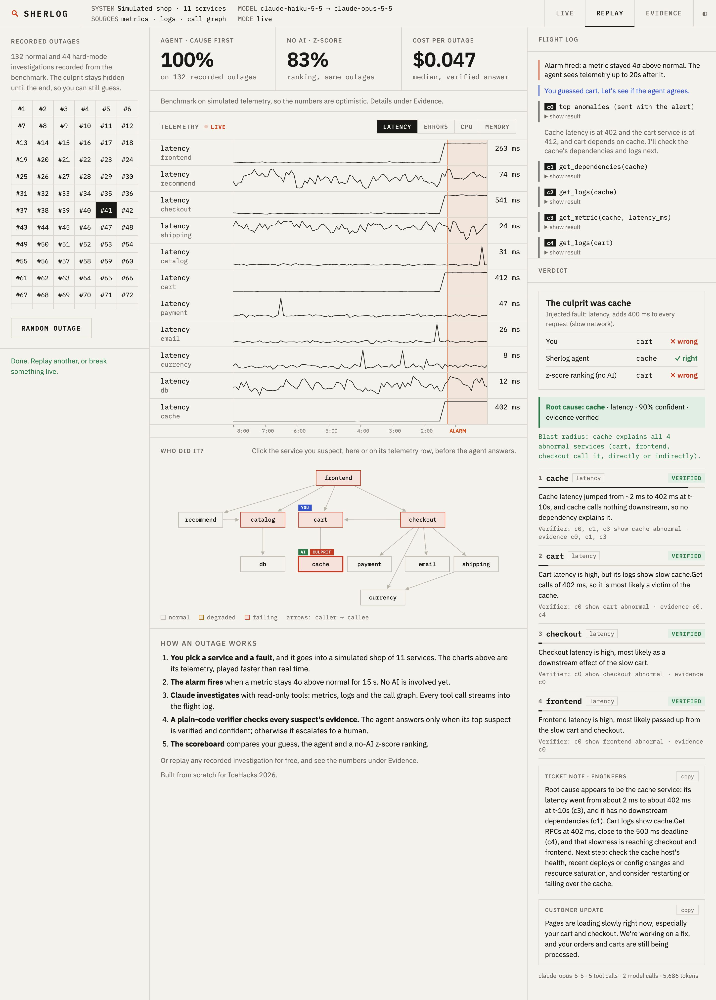
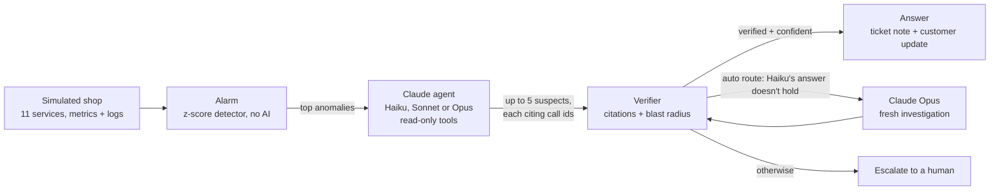

# Sherlog

**Break a service. Guess the culprit. Watch an AI agent find it, and prove it.**

**Live:** https://sherlog-jade.vercel.app (the story) · https://sherlog-jade.vercel.app/console (break something) · **Code:** https://github.com/shaunmortal/sherlog

When one service in a microservice app breaks, everything that calls it breaks too. The on-call
engineer is woken up by a wall of red and has to work out which service is the *cause* and which
are just *victims*. Sherlog is an AI on-call investigator for that moment:

1. An alarm fires on a (simulated) online shop of 11 microservices.
2. A Claude agent investigates with read-only tools: metrics, logs and the call graph.
3. It ranks up to five suspects and cites the exact tool calls that back each one.
4. A **deterministic verifier** (plain Python, no AI) checks every citation. A suspect whose cited
   evidence doesn't show it abnormal is rejected. The agent only answers when its top suspect is
   verified and confident; otherwise it escalates to a human.
5. It drafts the ticket note for engineers and the status update for customers.

You can play along: lock in your own guess before the agent answers, and see who wins: you, the
agent, or a classic no-AI ranking. Pick who investigates (Claude Haiku, Sonnet, Opus, or **auto**:
Haiku first, Opus only when Haiku's answer doesn't hold up), and switch on **hard mode** for a decoy.



## Results

**132 outages**, three for every service × fault type (seeds 1000-1131), never looked at while the
prompt and tools were built. "Cause first" = the true cause ranked first and, for the agent, accepted
by the verifier. Brackets are 95% Wilson intervals.

| Method | Cause first | In top 3 | Answered without a human | Median cost |
|---|---:|---:|---:|---:|
| No AI: rank services by z-score | 83% [75-88] | 100% | - | - |
| No AI: robust z-score (median and MAD, as BARO-style methods use) | 78% [70-84] | 100% | - | - |
| Claude Opus 5.5, one prompt, no tools | 100% [97-100] | 100% | 107 of 132 | $0.020 |
| Sherlog agent on Claude Haiku 5.5 | 100% [97-100] | 100% | 129 of 132 | $0.0015 |
| Sherlog agent on Claude Sonnet 5.5 | 100% [97-100] | 100% | 130 of 132 | $0.014 |
| Sherlog agent on Claude Opus 5.5 | 100% [97-100] | 100% | 132 of 132 | $0.047 |
| **Sherlog auto** (Haiku first, Opus in 4 of 132) | **100% [97-100]** | 100% | **132 of 132** | **$0.0015** |

Against the no-AI ranking on the same outages, the Opus agent alone was right in 23 and the ranking
alone in none (exact McNemar test, p < 0.001).

**Hard mode: 44 outages** (seeds 2000-2043) with a **decoy**, an unrelated service with a harmless
anomaly that starts with the fault (a batch job pinning a CPU, a cache warm-up filling a heap), and
callers that log 60% fewer complaints.

| Method | Cause first | Answered without a human | Right when it answered | Median cost |
|---|---:|---:|---:|---:|
| No AI: rank services by z-score | 66% [51-78] | - | - | - |
| No AI: robust z-score | 57% | - | - | - |
| Claude Opus 5.5, one prompt, no tools | 80% | 4 of 44 | 100% | $0.023 |
| Sherlog agent on Claude Haiku 5.5 | 86% | 33 of 44 | 85% | $0.0023 |
| Sherlog agent on Claude Sonnet 5.5 | 86% | 24 of 44 | 92% | $0.016 |
| **Sherlog agent on Claude Opus 5.5** | **98% [88-100]** | 29 of 44 | **100%** | $0.056 |
| Sherlog auto (Haiku first, Opus in 12 of 44) | 91% | 34 of 44 | 88% | $0.0024 |

**What the numbers say.**

- **Reasoning beats ranking.** The no-AI rankings blame a victim in 17-22% of normal outages and a
  third or more of hard ones. Every Claude variant reasons about who calls whom and does better.
- **Investigation turns a guess into an answer you can act on.** One prompt, no tools, was as accurate
  on normal outages but confident enough to answer only 107 of 132, and only 4 of 44 hard ones. With
  tools the agent gathers evidence that the verifier can check.
- **Bigger models earn their keep on hard outages.** On normal outages Haiku is as good as Opus at a
  thirtieth of the cost, so **auto** routing gets Opus-level results for $0.0015. With a decoy, Haiku
  was confidently fooled 5 times and Sonnet twice; Opus never answered wrong, and handed the 15
  outages it wasn't sure about to a human. Auto keeps most of Opus's accuracy at 1/23 of its cost.
- **The blast-radius check.** The verifier also asks whether the answer explains the outage: every
  abnormal service should be the answer or one of its callers, and only slowness and failures travel
  to callers. 131 of the Opus agent's 132 answers explain every abnormal service, and the check flags
  all 23 of the no-AI ranking's wrong answers. A decoy can still slip past it when the real fault does
  not spread to any caller, which is why hard mode stays hard.
- **Logs were not needed on normal outages** (an agent without logs scored the same on 44 of them).

**Why the no-AI ranking fails.** Ranking services by how far their metrics moved (z-score) is the
standard baseline. It breaks when a victim is *quieter* than the cause: if `cart` normally has very
steady latency and `cache` is noisy, a slowdown in `cache` makes `cart` look more abnormal than
`cache` itself. And it cannot tell a decoy from a cause. The agent follows the call graph and the
callers' logs to the unhealthy service that explains everything else.

Reproduce everything: `uv run --env-file .env python bench.py --n 132 --variant agent` (variants:
`one-shot`, `haiku`, `sonnet`, `no-logs`, and `hard-*` with `--n 44`), then `python bench.py --report`.
Every run, with every tool call and the model's reasoning, is recorded in [`runs/`](runs); the Opus
runs are replayable in the console (normal as #1-#132, hard mode as H1-H44), and the Evidence view
shows all the tables.

## How it works



- **Simulator** ([`sim.py`](sim.py)). A seeded model of a shop: frontend, catalog, cart, checkout,
  payment and six more, wired by a call graph. Four fault types (network latency, a bad deploy that
  throws errors, CPU starvation, a memory leak). Latency and errors flow upward to callers; callers
  log "rpc payment.Charge failed" naming the *callee*; a network delay leaves no trace in the broken
  service's own logs. Telemetry is noisy in different ways, as it is in production: busy services
  jitter densely, others sit flat with the odd tall spike or drift slowly, quiet services report few
  fresh samples, error rates are counted from each tick's requests (mostly zero on a quiet service),
  and heaps saw up and down with garbage collection. How noisy each service is changes from outage
  to outage, plus routine and red-herring log lines. **Hard mode** adds a decoy (an unrelated
  service with a harmless CPU or memory anomaly starting with the fault) and cuts caller logging by
  60%.
- **Alarm.** A metric staying 4 standard deviations above its 5-minute baseline for 15 s. Detection
  is deliberately not AI, so the agent's contribution can be measured on its own.
- **Agent** ([`investigate.py`](investigate.py)). Claude Haiku 5.5, Sonnet 5.5 or Opus 5.5 through
  the Anthropic Messages API with tool use: `get_metric`, `get_logs`, `get_dependencies` and
  `submit_ranking`, all with strict schemas. Adaptive thinking (its summaries are streamed into the
  console), at most 8 rounds of tool calls, server-side refusal fallbacks on Opus. **Auto** runs Haiku
  first and hands over to a fresh Opus investigation only when Haiku's answer doesn't hold up.
- **Verifier.** Each tool call records which services its result showed abnormal (z ≥ 3, or at least
  two warning lines implicating the service). A suspect is accepted only if one of the calls it cites
  was really made and showed it abnormal. The answer is given only if suspect #1 is verified with
  confidence ≥ 80%; anything else is escalated. The **blast-radius check** then asks whether the answer
  explains the outage: every service that stayed abnormal should be the answer or one of its callers
  (callers only count if the answer's own latency or errors are up, because a busy CPU slows no one
  down by itself), and no other service may explain more of it.
- **Story page** ([`static/landing.html`](static/landing.html), [`static/hero3d.js`](static/hero3d.js), at `/`).
  One recorded outage told as a scroll story: the hero plays it on a loop on the shop's call graph in 3D
  (three.js; a flat map where WebGL is missing); behind the page a ribbon
  ([`static/ribbon.js`](static/ribbon.js)) travels across the screen as you scroll and bends away from
  the pointer, over a clear liquid surface (a wave simulation on the GPU) that ripples wherever the pointer moves; a "wall of red" asks you to pick the cause, a pinned
  stage walks through the alarm, the investigation, the verifier and the verdict, and the benchmark
  bars fill in as you reach them. Every number and line on it is read from the API, none typed in.
- **Console** ([`app.py`](app.py), [`static/index.html`](static/index.html), at `/console`). FastAPI streams the
  investigation as server-sent events to a page with no framework. Live, Replay and Evidence
  views; live-scrolling telemetry (the healthy shop runs while idle, and an outage plays in as it
  happens) with a hover readout; a service map to lock in your guess; a choice of investigator and
  difficulty; the agent's flight log; the verdict with its blast radius and the scoreboard; and the
  benchmark tables. Recorded outages replay
  without spending API credits; live runs are rate-limited per visitor.

## Run it

```bash
uv venv --python 3.13 && uv pip install -r requirements.txt
cp .env.example .env        # then put your Anthropic API key in .env
uv run --env-file .env uvicorn app:app --reload
# open http://localhost:8000 for the story, or http://localhost:8000/console to break something
```

Without an API key the console still works with the recorded outages. Tests:
`uv pip install pytest && .venv/bin/python -m pytest -q`.

**Deploy (Vercel).** `vercel env add ANTHROPIC_API_KEY production`, then `vercel --prod`.
FastAPI apps in `app.py` are detected automatically. Live runs cost $0.002-0.06 each, and the
built-in rate limit is per server instance, so also set a monthly spend limit on the API key in the
Anthropic Console.

## Limitations

- **The telemetry is simulated.** We wrote the simulator, so it is cleaner than production even with
  its noise textures: caller logs name the failing callee and there is one real fault at a time. On
  normal outages every Claude variant scores 100%, so they differ only in cost and in how often they
  can answer safely; hard mode is what separates them. The no-AI baselines run on exactly the same
  data, so the comparisons are fair, but the absolute numbers are optimistic.
- 132 normal and 44 hard outages are still small benchmarks: the 95% intervals are shown for that
  reason, and on 44 outages one miss moves a score by 2.3 points.
- A decoy is one kind of real-world confusion; others (two faults at once, flapping, retry storms) are
  not simulated yet.
- The rate limiter is in memory, so it is per server instance.

## What's next

- Run on a public benchmark of real outages ([RCAEval](https://github.com/phamquiluan/RCAEval)).
- Harder faults: two at once, intermittent faults, cascading retries.
- Connect to real telemetry (Prometheus alerts in, Slack message out).

## Built with

Python, FastAPI, the Anthropic Python SDK (Claude Haiku 5.5, Sonnet 5.5 and Opus 5.5: tool use,
adaptive thinking, strict tool schemas), vanilla JavaScript, canvas and SVG, three.js (MIT, loaded from
jsDelivr) for the story page's 3D call graph, and the Geist fonts (SIL Open Font License). Developed with Claude Code
as an AI pair programmer.

## License

Written from scratch during IceHacks 2026. MIT License.
