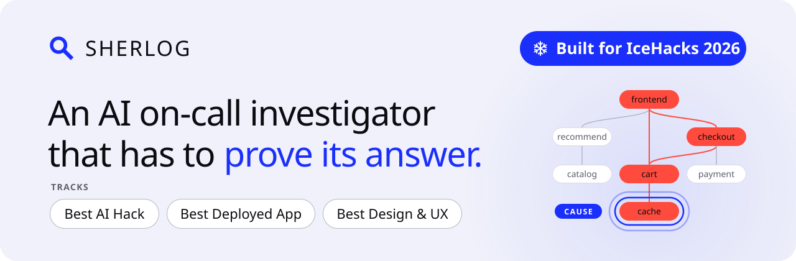
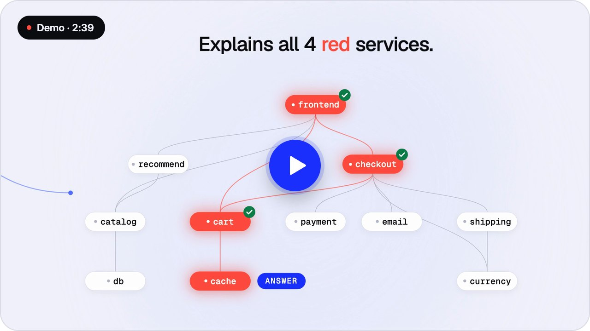
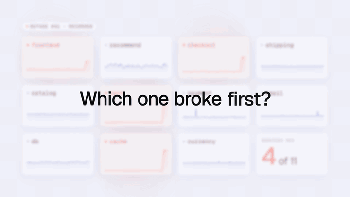
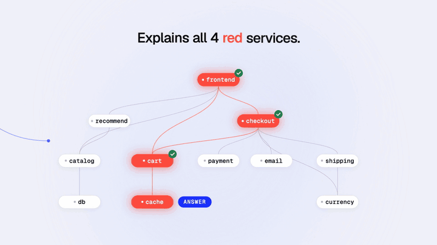
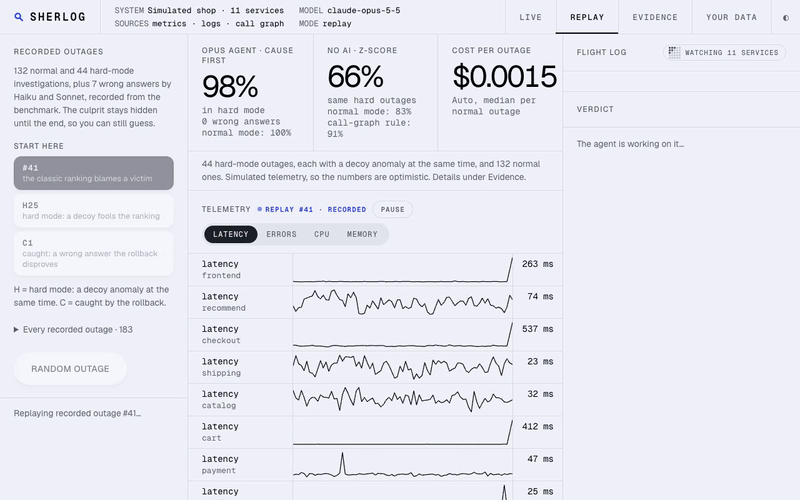
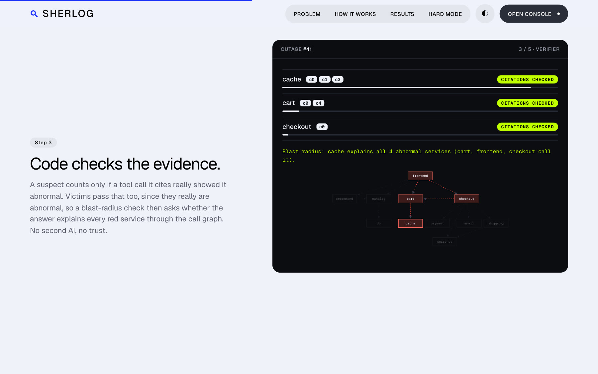
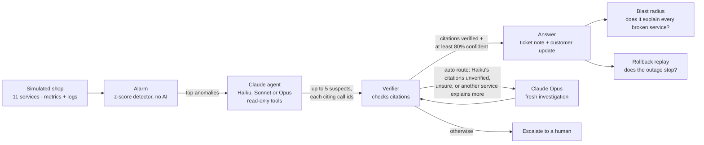

<h1 align="center">
  <a href="https://sherlog-jade.vercel.app">
    <picture>
      <source media="(prefers-color-scheme: dark)" srcset="media/banner-dark.svg">
      
    </picture>
  </a>
</h1>

<p align="center"><b>When one service breaks, everything that calls it breaks too, and the one that looks worst is often only a victim. Sherlog finds the one that broke, and has to prove it</b>: plain code checks every tool call it cites, and a replay with its answer rolled back shows whether the outage really stops.</p>

<p align="center">
  <a href="https://sherlog-jade.vercel.app"></a>&nbsp;&nbsp;
  <a href="https://sherlog-jade.vercel.app/console"></a>&nbsp;&nbsp;
  <a href="https://sherlog-jade.vercel.app/status"></a>
</p>

<p align="center">
  <a href="https://github.com/shaunmortal/sherlog/actions/workflows/tests.yml"></a>
  
  <a href="LICENSE"></a>
</p>

<p align="center"><a href="https://youtu.be/UfL1R6MzmKQ"><picture><source media="(prefers-color-scheme: dark)" srcset="media/video-thumb-dark.jpg"></picture></a></p>
<p align="center"><a href="https://youtu.be/UfL1R6MzmKQ"><b>▶&nbsp;Watch the 2:48 demo</b></a></p>

<p align="center">
  <picture>
    <source media="(prefers-color-scheme: dark)" srcset="media/stats-dark.svg">
    
  </picture>
</p>
<p align="center"><sub>The real-outage numbers are in <a href="runs/real-benchmark/results.json"><code>runs/real-benchmark/results.json</code></a> and the controlled benchmark's in <a href="runs/evidence.json"><code>runs/evidence.json</code></a>, both recomputed from the recorded runs with no API key.</sub></p>

**Contents:** [Built for IceHacks](#built-for-icehacks-2026) · [Real outages](#real-outages-a-public-benchmark) · [Evaluate it in 5 minutes](#evaluate-it-in-5-minutes) · [See it work](#see-it-work) · [Who it is for](#who-it-is-for) · [What's new](#whats-new-here) · [Try it in 30 seconds](#try-it-in-30-seconds) · [How it works](#how-it-works) · [Controlled benchmark](#the-controlled-benchmark-decoy-mode-rollback-replay) · [Accessibility](#accessibility) · [Reliability](#reliability) · [Bring your own outage](#bring-your-own-outage) · [MCP](#use-it-from-claude-mcp) · [Docs](#docs) · [Reproduce](#reproduce) · [Layout](#repository-layout) · [How it was built](#how-it-was-built)

---

## Built for IceHacks 2026

Sherlog was built during IceHacks 2026, on Nov 14 and 15 (IST), with Claude Code as an AI pair programmer and Claude Haiku, Sonnet and Opus 5.5 inside the product. [How it was built](#how-it-was-built) has the dated log, from the first test run to the last review fix. It is entered in three tracks:

| Track | Why it fits, and where to check |
|---|---|
| **Best&nbsp;AI&nbsp;Hack** | A Claude agent investigates with read-only tools and must cite the tool calls behind each suspect. Plain code checks every citation, and a replay with the answer rolled back tests it. **On 252 real outages of a public benchmark it ranked the root cause first in 92%, against 80–81% for the best published methods re-run on the same cases (against n-sigma, case by case, 40 to 9, p = 9.3e-6) and 83% for the same inputs without the AI**, for a median $0.0024 an outage. In the controlled benchmark's hard mode, the Opus agent named the cause first in 43 of 44 and never answered wrong.<br>**Check it:** [Real outages](#real-outages-a-public-benchmark) · [What's new](#whats-new-here) · [How it works](#how-it-works) · [a caught wrong answer](https://sherlog-jade.vercel.app/console#replay/177) |
| **Best&nbsp;Deployed&nbsp;App** | Live, with a status page and a health endpoint. All 183 recorded investigations replay with no API key; live runs are rate-limited and fail with a clear reason; 1,829 tests and 73 browser checks run in CI on every push, 1,285 of them in a reproducibility suite that re-runs all 1,100 recorded runs from their seeds; every response carries a strict content security policy and the usual security headers; every real-outage number recomputes from the committed run records with no key; an MCP connector at `/mcp` lets Claude use it as a tool; a scheduled uptime check covers the pages, the health endpoint, MCP and the security headers.<br>**Check it:** [Live site](https://sherlog-jade.vercel.app) · [`/status`](https://sherlog-jade.vercel.app/status) · [`/api/health`](https://sherlog-jade.vercel.app/api/health) · [CI](https://github.com/shaunmortal/sherlog/actions/workflows/tests.yml) · [uptime check](.github/workflows/uptime.yml) · [Reliability](#reliability) |
| **Best&nbsp;Design&nbsp;&amp;&nbsp;UX** | A scroll story you can play: guess which service broke, then watch the agent investigate, check and roll back; the story page's results and the console's evidence lead with the real outages. Built to WCAG 2.2 AA, with 0 axe-core violations on the story page, the console and the status page, in both themes, at desktop and phone sizes; full keyboard use, screen-reader announcements and pausable motion.<br>**Check it:** [Story page](https://sherlog-jade.vercel.app) · [Console](https://sherlog-jade.vercel.app/console) · [Accessibility](#accessibility) |

## Real outages: a public benchmark

Data: RCAEval benchmark, MIT licence, <https://huggingface.co/datasets/phamquiluan/RCAEval>

Sherlog was run on **252 held-out real outages**: three real microservice systems (12, 15 and 68 services), each broken on purpose by a known fault while its telemetry was recorded. On them, the most abnormal service was not the cause 22% of the time. Every method was scored by the benchmark's own evaluator, and the published baselines were re-run on the same cases with the benchmark's own runner. The dev/test split was frozen before the first live call, and no change came from a result on a test case.

| Method · 252 real outages | Ranked first (AC@1) | In top 3 (AC@3) | Avg@5 |
|---|---:|---:|---:|
| **Sherlog agent, auto route** (Claude Haiku 5.5, Claude Opus 5.5 when needed) | **92%** (95% CI 88–95%) | **96%** | **0.95** |
| Sherlog's own call-graph rule, no AI, the same inputs | 83% | 91% | 0.90 |
| Published baseline: multi-source n-sigma (metrics, logs, traces) | 81% | 93% | 0.91 |
| Published baseline: n-sigma (metrics) | 80% | 91% | 0.90 |
| Published baseline: BARO (metrics) | 29% | 88% | 0.77 |

AC@k: the root-cause service is among the method's first k suspects. Avg@5: the mean of AC@1 to AC@5.

- **Ahead of the best published methods, case by case.** Sherlog was right where n-sigma was wrong in 40 outages, and n-sigma right where Sherlog was wrong in 9 (exact McNemar test, p = 9.3e-6); against multi-source n-sigma, 39 and 10 (p = 3.9e-5).
- **92% vs 83% on the same inputs without the AI.** Sherlog's call-graph rule reads the same telemetry and call graph with no AI; the agent was right where the rule was wrong in 26 outages, and the reverse in 2 (p = 3.0e-6).
- **A median $0.0024 an outage**, $8.01 for all 252: Claude Haiku's answer stood in 189 cases, and Claude Opus took over in 63.
- **It answers when it is sure.** It answered 214 of the 252 on its own, 208 of them right, and handed the other 38 to a person.
- **A second suite, code-level faults.** On the benchmark's 81 held-out cases where a faulty code change is deployed, it named the cause first in 53 of the 54 on the 12- and 15-service systems, with no wrong answer there ([the RE3 section](docs/real-benchmark.md#a-second-suite-code-level-faults-re3)).

The protocol (blind cases, the frozen split, the deviations from the benchmark's own) and every table, by system and by fault: [docs/real-benchmark.md](docs/real-benchmark.md). `python scripts/benchmark/report.py` recomputes every number in [`runs/real-benchmark/results.json`](runs/real-benchmark/results.json) from the committed run records, with no key.

### On a real running system, with real rollbacks

Sherlog also ran on a real system of 8 services, each its own OS process calling the others over HTTP under steady load, with real faults injected: slow requests, exceptions, busy CPUs and a memory leak, and in hard mode a harmless decoy at the same time. The agent investigated through the same path as `POST /api/investigate`, then its answer was **rolled back for real** while the system kept running. Details: [docs/real-system.md](docs/real-system.md).

- **The real rollback caught every wrong answer it tested.** Rolling back a service that was not the cause never stopped the alarm (0 of 10), and rolling back the true cause stopped it in 27 of 29.
- **Sherlog on Opus never answered wrong:** 26 answers on 30 real outages, all right; the hardest it handed to a person.
- **Plugs into standard metrics.** One outage came the way a team running Prometheus would send it: the services' `/metrics` were scraped every 5 s and converted by [`scripts/prom_to_sherlog.py`](scripts/prom_to_sherlog.py), and Sherlog named the cause from that document alone (no Prometheus server ran; the query answers were computed from the scraped samples).
- **$1.69 for all of it.**

## Evaluate it in 5 minutes

| Minute | Open | What you should see |
|---|---|---|
| 0:00–2:48 | The demo video (link above) | The whole loop: an outage, a guess, the investigation, the checks, the rollback, and the results on the controlled benchmark and on 252 real outages. |
| 2:50–3:10 | [`/console#replay/41`](https://sherlog-jade.vercel.app/console#replay/41) | A recorded outage, free, in about 11 s, or at once with **Skip to verdict**. The z-score ranking blames `cart`; the agent names `cache`, 90% sure, citing calls `c0`, `c1` and `c3`, all verified; rolling `cache` back clears all four broken services. |
| 3:10–3:25 | [`/console#replay/177`](https://sherlog-jade.vercel.app/console#replay/177) (C1 in the Replay tab) | A confident wrong answer the rollback stopped. In hard mode the Haiku agent names `cart`, the decoy, 85% sure, with its citations verified, so it goes out; rolling `cart` back leaves `frontend` abnormal and the alarm on, so the rollback does not prove it. |
| 3:25–3:40 | [Your data](https://sherlog-jade.vercel.app/console#data) → **Use** the shop sample → **Triage (no AI)**, then **Use** a custom-graph sample → **Triage** | No key needed. The alarm, the z-score ranking (`cart` first), the robust z-score (`cache` first) and the blast-radius check, which says `cache` would explain more of the outage than `cart`. The custom-graph sample brings its own call graph of six services, which replace the shop on the charts and the map. |
| 3:40–4:00 | [`docs/real-benchmark.md`](docs/real-benchmark.md), then in a clone `python scripts/benchmark/report.py` | The real outages: the protocol and every table. The script recomputes every number in [`runs/real-benchmark/results.json`](runs/real-benchmark/results.json) from the committed run records, with no key, in about 1 s, and stops if one differs from the benchmark's own evaluator. |
| 4:00–5:00 | A clone of this repository, no key | `pytest -q`: 1,829 passed and 1 skipped (the browser checks, which need a running server), in under a minute. `python bench.py --report`: every controlled-benchmark table and a fresh [`runs/evidence.json`](runs/evidence.json) from the recorded runs, with no API calls, in about 14 s. |

```bash
uv run --with-requirements requirements.txt --with pytest --with httpx pytest -q
uv run --with-requirements requirements.txt python bench.py --report
uv run --with-requirements requirements.txt python scripts/benchmark/report.py
```

## See it work

<table>
  <tr>
    <td width="50%"></td>
    <td width="50%"></td>
  </tr>
  <tr>
    <td><b>1. The trap.</b> The loudest service is a victim. A person and the classic no-AI ranking both blame it.</td>
    <td><b>2. The proof.</b> The answer must explain every red service, and rolling it back must stop the outage. A decoy can't fake that.</td>
  </tr>
  <tr>
    <td colspan="2"></td>
  </tr>
  <tr>
    <td colspan="2"><b>3. The real console</b>, recorded from the live site: <a href="https://sherlog-jade.vercel.app/console#replay/41">replay #41</a> plays free, with no API key.</td>
  </tr>
</table>

---

## Who it is for

- **The on-call engineer facing a wall of red**, who needs the one service that broke, the tool calls that show it, and a ticket note, or a clear hand-over when the agent is not sure.
- **Teams deciding whether to trust an AI on-call agent**, who can reuse the verify-then-rollback gate and the benchmark protocol: held-out seeds, a decoy mode, no-AI baselines and paired tests.
- **People practising triage**, through the guess game: you against Claude and the no-AI z-score ranking on the same outage.

---

## What's new here

- **Answers must prove themselves.** Every suspect cites the tool calls (`c0`, `c1`, …) behind it, and plain code, not a second AI, checks that each cited call really showed that service abnormal. Only a top suspect with its citations verified, at 80% confidence or more, goes out; everything else goes to a human. A victim is abnormal too, so its citations pass: this check catches citations that do not show what they claim, and the blast-radius check and the rollback replay tell the cause from its victims.
  *In hard mode the Opus agent answered 29 of 44 outages on its own, all right, and handed the other 15 to a human.*
- **Proof by intervention.** After the verdict, Sherlog replays the same outage, with the same noise, and its answer rolled back. Roll back the cause and the slowness and errors stop; roll back a victim or a decoy and they carry on, so a decoy that fools every check that only looks cannot fool this one. This is possible because the shop is simulated, where rolling back the cause is exactly what clears the fault; in production the same idea is a canary rollback, which is noisier.
  *Over the recorded runs of the four single-model methods, it would have caught all 7 wrong hard-mode answers and rejected none of the 83 right ones. The 7 replay for free as C1–C7 in the console.*
- **A hard mode where the models separate.** On normal outages every Claude variant scores 100%, which says nothing. Hard mode adds a decoy: a service the fault cannot reach, with a harmless anomaly that starts with the fault.
  *Opus named the cause first in 43 of 44 and never answered wrong; Haiku answered 5 wrong, Sonnet 2. A no-AI call-graph rule names the cause in 40, but it always answers, so it is wrong in 4.*
- **You vs Claude vs the z-score ranking.** Lock in your guess before the agent answers. The scoreboard shows who was right: you, Claude, or the standard no-AI z-score ranking.
  *The z-score ranking blames a victim in 23 of 132 normal outages; the agent in none. A stronger no-AI rule, the call-graph rule, misses only 1 there; on real outages the agent beats it, 92% to 83%: see [Real outages](#real-outages-a-public-benchmark).*
- **Verifier-gated model routing.** **Auto** lets Claude Haiku go first. A fresh Opus investigation starts only when Haiku's answer fails the verifier, is under 80% sure, or another service would explain more of the outage.
  *It answered all 132 normal outages, all right, for a median $0.0015 each, calling Opus in 4.*

---

## Try it in 30 seconds

<p align="center"><a href="https://sherlog-jade.vercel.app"></a></p>

1. **Guess.** On the [story page](https://sherlog-jade.vercel.app), scroll to the wall of red and pick the service you think broke. It shows the cause and which ones were only victims.
2. **Break a service.** In the [console](https://sherlog-jade.vercel.app/console), pick a service, a fault and who investigates, press **Break it live**, then lock in your guess on the map while Claude works. Or replay [outage #41](https://sherlog-jade.vercel.app/console#replay/41) for free: the z-score ranking blames `cart`, the agent names `cache`, and rolling `cache` back clears all four broken services.
3. **Bring your own outage.** In the console's **Your data** tab, press **Use** the shop sample, then **Triage (no AI)**. The alarm, the z-score and robust z-score rankings and the blast-radius check run on it, with no API key. **Investigate with Claude** runs the agent on it. Your own system does not have to look like the shop: an upload can bring its own call graph, as the custom-graph sample does.

<table>
  <tr>
    <td width="50%"></td>
    <td width="50%"></td>
  </tr>
  <tr>
    <td><em>A wall of red: pick the one that broke, then see which were victims.</em></td>
    <td><em>A pinned stage walks through the alarm, the investigation, the verifier, the verdict and the rollback.</em></td>
  </tr>
</table>

---

## How it works



1. **Detect.** The alarm fires when a metric stays 4σ above its normal level for 15 seconds. It is deliberately not AI, so what the AI adds can be measured on its own.
2. **Investigate.** The agent starts from the top anomalies and works through at most 8 rounds of read-only tools (`get_metric`, `get_logs`, `get_dependencies`), then submits up to five suspects, each with a fault type, one sentence of reasoning, a confidence and the ids of the tool calls that support it. It is never told what broke.
3. **Verify.** Every tool call records which services its result showed abnormal (z ≥ 3, or at least two warning lines implicating the service). A suspect is accepted only if a call it cites really showed it abnormal. This checks the citations, not the answer: a victim is abnormal too, so its citations pass, and step 5's checks are what tell it from the cause.
4. **Answer, or hand over.** If suspect #1's citations are verified and it is at least 80% confident, Sherlog answers and drafts the ticket note and the customer update. Anything less goes to a human; on the auto route, a doubtful Haiku answer goes to a fresh Opus investigation first.
5. **Check the answer.** The **blast-radius check** asks whether the answer explains every service that stayed abnormal: each must be the answer or one of its callers, and only slowness and failures travel to callers. The **rollback replay** re-runs the outage from its seed with the answer rolled back and reports whether the alarm stops and which services recover. In hard mode the decoy's harmless CPU or memory anomaly can keep the alarm on, so the replay also counts as proof when every latency and error alarm ends. Both results are shown next to the verdict and neither changes it, with one exception: on the auto route, a Haiku answer that another service would explain better goes to Opus first.

<p align="center"></p>
<p align="center"><em>Outage #41 in the console: the slowdown in <code>cache</code> makes cart, checkout and frontend look broken too. The z-score ranking blames <code>cart</code>; the agent names <code>cache</code>, and rolling <code>cache</code> back clears the outage.</em></p>

---

## The controlled benchmark (decoy mode, rollback replay)

A simulated shop where every outage replays from its seed, which gives two things real data cannot: a decoy mode, and the rollback replay. **132 normal outages**, three for every service and fault type (seeds 1000–1131), and **44 hard-mode outages** with a decoy (seeds 2000–2043). None were looked at while the prompt and tools were built. "Cause first" means the true cause was ranked first *and* its citations were verified. Every figure in the tables is in [`runs/evidence.json`](runs/evidence.json), computed from the recorded runs in [`runs/`](runs).

<p align="center"></p>

| Method | Cause first, normal · hard | Answered alone, normal · hard | Wrong answers, hard | Median cost |
|---|---:|---:|---:|---:|
| No AI: rank services by z-score | 83% · 66% | always | 15 | – |
| No AI: robust z-score (median and MAD) | 78% · 57% | always | 19 | – |
| No AI: call-graph rule | 99% · 91% | always | 4 | – |
| Claude Opus 5.5, one prompt, no tools | 100% · 80% | 107 · 4 | 0 | $0.020 |
| Sherlog agent on Claude Haiku 5.5 | 100% · 86% | 129 · 33 | 5 | $0.0015 |
| Sherlog agent on Claude Sonnet 5.5 | 100% · 86% | 130 · 24 | 2 | $0.014 |
| **Sherlog agent on Claude Opus 5.5** | **100% · 98%** | **132 · 29** | **0** | $0.047 |
| **Sherlog auto** (Haiku first, then Opus) | 100% · 91% | 132 · 34 | 4 | **$0.0015** |

No Claude method answered a normal outage wrong. The no-AI methods always name a service, so every miss is a wrong answer: on normal outages, 23 for the z-score ranking, 29 for the robust z-score and 1 for the call-graph rule. Median cost is per normal outage. Auto was not run on its own: its rows apply the live route's handoff rule to the recorded Haiku and Opus runs on the same outages, paying for both when Haiku hands over.

- **The agent beats the z-score ranking.** The Opus agent was right where the z-score ranking was wrong in 23 normal and 14 hard outages, never the reverse (exact McNemar test, p = 2.4e-7 and p = 0.0001).
- **The no-AI call-graph rule.** Among the services that stayed abnormal, it names the one that explains the most of the others through the call graph (each must be it or one of its callers), ties broken by z-score: the blast-radius check's reasoning, with no logs and no AI. It names the cause first in 131 of 132 normal and 40 of 44 hard outages. The Opus agent was right where the rule was wrong in 1 normal and 3 hard outages, never the reverse, which on benchmarks this size could be chance (exact McNemar test, p = 1.0 and p = 0.25). In hard mode the Haiku and Sonnet agents (86%) and one-prompt Opus (80%) score below the rule, and auto (91%) ties it.
- **What the AI adds over the rule.** The rule always answers, so in hard mode it was wrong in 4 of 44, each time naming the decoy. The Opus agent answered 29 on its own, all right, and handed the other 15 to a human, each with a ticket note. Every answer also comes with reasoning a person can read, citations code can check, and a customer update. The rollback replay is not AI and checks the rule's answers too: see the gate what-if below.
- **Investigation turns a guess into an answer.** One prompt with no tools was as accurate on normal outages, but sure enough to answer only 107 of 132, and 4 of 44 hard ones.
- **The blast-radius check catches the z-score ranking's mistake.** On normal outages it flags all 23 of the z-score ranking's wrong answers and only 1 of the Opus agent's 132 right ones. In hard mode it flags all 29 of the Opus agent's answers, because the decoy is never explained.

### The rollback replay, over the recorded answers

The rollback test was applied offline to every recorded answer: each outage was re-simulated from its seed with the answer rolled back. No API calls; `python bench.py --report` recomputes it. The numbers below show how the gate behaves in the simulator (see [Limitations](#limitations)).

| Method | Normal: answers · proven | Hard: answers · proven | Hard: wrong answers · caught | Right answers rejected |
|---|---:|---:|---:|---:|
| Claude Opus 5.5, one prompt | 107 · 107 | 4 · 4 | 0 · 0 | 0 |
| Agent on Haiku 5.5 | 129 · 129 | 33 · 28 | 5 · 5 | 0 |
| Agent on Sonnet 5.5 | 130 · 130 | 24 · 22 | 2 · 2 | 0 |
| Agent on Opus 5.5 | 132 · 132 | 29 · 29 | 0 · 0 | 0 |
| Auto | 132 · 132 | 34 · 30 | 4 · 4 | 0 |

The 7 wrong answers it caught, 5 from Haiku and 2 from Sonnet, replay for free as C1–C7 in the console's Replay tab, listed by [`GET /api/replays`](https://sherlog-jade.vercel.app/api/replays) as `caught` (numbers 177 to 183). Each went out with its citations verified and 80% to 88% confidence, each named the decoy, and in each the rollback leaves the alarm on.

### What if the rollback were the answer gate? (offline what-if)

Today Sherlog answers when its top suspect's citations are verified and it is at least 80% confident. This **what-if over the recorded verdicts** asks what would happen if it answered whenever the rollback proves the top suspect, its citations verified, whatever its confidence. Hard mode, 44 outages, answered · right:

| Method | Today: 80% confidence gate | Rollback gate | Either gate |
|---|---:|---:|---:|
| Claude Opus 5.5, one prompt | 4 · 4 | 34 · 34 | 34 · 34 |
| Agent on Haiku 5.5 | 33 · 28 | 37 · 37 | 42 · 37 |
| Agent on Sonnet 5.5 | 24 · 22 | 37 · 37 | 39 · 37 |
| Agent on Opus 5.5 | 29 · 29 | 42 · 42 | 42 · 42 |

With the rollback as the gate, no method answers wrong in the simulator, and Opus answers 42 hard outages instead of 29. Adding it to today's gate does not remove a wrong answer, because those answers were confident. On normal outages the rollback gate answers all 132, all right, for every method here. Auto is left out: its handoff to Opus itself depends on the confidence gate. The rollback gate does not need the AI: applied to the no-AI call-graph rule's first pick on the same seeds, it would answer 131 of 132 normal and 39 of 44 hard outages, all right, against the Opus agent's 132 and 42 (computed with `investigate.graph_ranking` and `investigate.rollback_check`; not part of `bench.py --report`). **The live product still uses the confidence gate** and shows the rollback result as extra evidence.

<details>
<summary><b>Normal benchmark, every method, with intervals · 132 outages</b></summary>

| Method | Cause first | In top 3 | Answered alone | Right when it answered | Median cost |
|---|---:|---:|---:|---:|---:|
| No AI: z-score ranking | 83% [75–88] | 100% | always | 83% | – |
| No AI: robust z-score (median and MAD) | 78% [70–84] | 100% | always | 78% | – |
| No AI: call-graph rule | 99% [96–100] | 100% | always | 99% | – |
| Claude Opus 5.5, one prompt, no tools | 100% [97–100] | 100% | 107 of 132 | 100% | $0.020 |
| Sherlog agent on Claude Haiku 5.5 | 100% [97–100] | 100% | 129 of 132 | 100% | $0.0015 |
| Sherlog agent on Claude Sonnet 5.5 | 100% [97–100] | 100% | 130 of 132 | 100% | $0.014 |
| Sherlog agent on Claude Opus 5.5 | 100% [97–100] | 100% | 132 of 132 | 100% | $0.047 |
| Sherlog auto (Opus needed in 4) | 100% [97–100] | 100% | 132 of 132 | 100% | $0.0015 |

Brackets are 95% Wilson intervals. By fault type, the z-score ranking names the cause first in 76% of latency faults, 76% of error faults, 79% of CPU faults and 100% of memory leaks; the Opus agent in 100% of each. An agent without `get_logs` scored 100% [92–100] on 44 normal outages, where the call-graph rule scored 98%. Every Claude method was right in the call-graph rule's one normal miss and never the reverse (exact McNemar p = 1.0).

</details>

<details>
<summary><b>Hard mode, every method, with intervals · 44 outages with a decoy</b></summary>

| Method | Cause first | Answered alone | Right when it answered | Median cost |
|---|---:|---:|---:|---:|
| No AI: z-score ranking | 66% [51–78] | always | 66% | – |
| No AI: robust z-score (median and MAD) | 57% [42–70] | always | 57% | – |
| No AI: call-graph rule | 91% [79–96] | always | 91% | – |
| Claude Opus 5.5, one prompt, no tools | 80% [66–89] | 4 of 44 | 100% | $0.023 |
| Sherlog agent on Claude Haiku 5.5 | 86% [73–94] | 33 of 44 | 85% | $0.0023 |
| Sherlog agent on Claude Sonnet 5.5 | 86% [73–94] | 24 of 44 | 92% | $0.016 |
| Sherlog agent on Claude Opus 5.5 | 98% [88–100] | 29 of 44 | 100% | $0.056 |
| Sherlog auto (Opus needed in 12) | 91% [79–96] | 34 of 44 | 88% | $0.0024 |

The z-score ranking's 15 misses name the decoy 7 times; the call-graph rule's 4 misses all name it. Against the call-graph rule, paired outage by outage (only the method right · only the rule right, exact McNemar p): one-prompt Opus 0 · 5, p = 0.06; Haiku agent 2 · 4, p = 0.69; Sonnet agent 0 · 2, p = 0.5; Opus agent 3 · 0, p = 0.25; auto 2 · 2, p = 1.0. Opus was right where Haiku or Sonnet was not in 5 outages each, and never the reverse: suggestive, but p = 0.06 on 44 outages.

<p align="center"></p>

</details>

<details>
<summary><b>How the benchmark works</b></summary>

**The shop.** [`sim.py`](sim.py) is a seeded model of an online shop: frontend, catalog, cart, checkout, payment and six more, wired by a call graph. Four faults: +400 ms of network latency, a bad deploy that fails 30% of requests, CPU starved at 97%, and a memory leak. Latency and errors flow up to callers; callers log `rpc payment.Charge failed`, naming the *callee*; a network delay leaves no trace in the broken service's own logs. Each service gets its own kind and amount of noise (dense jitter, flat lines with tall spikes, slow drift, sparse samples, garbage-collection sawtooths), and it changes from outage to outage. In 1,500 simulated healthy shops, 6 raised a false alarm (0.4%).

**Hard mode** adds the decoy (never the culprit or one of its callers; a batch job pinning a CPU, or a cache warm-up filling a heap) and callers log 60% fewer complaints.

**Why the z-score ranking fails.** Ranking services by how far their metrics moved (z-score) is the standard baseline. It breaks when a victim is *quieter* than the cause: if `cart` normally has very steady latency and `cache` is noisy, a slowdown in `cache` makes `cart` look more abnormal than `cache` itself. It also cannot tell a decoy from a cause. The agent follows the call graph and the callers' logs instead.

**Where the call-graph rule fails.** The rule ([`investigate.graph_ranking`](investigate.py)) fixes the quiet victim, because a victim explains fewer of the broken services than its cause. It fails when no caller of the cause stays abnormal: then the cause explains only itself, as the decoy does, and the decoy wins the tie when its z-score is higher. All 4 of its hard-mode misses are this case.

**Scoring.** A wrong or rejected top suspect, no submission or a failed run is a miss. "Answered alone" and "right when it answered" report the answer-or-escalate decision separately. Each method is compared with the z-score ranking and with the call-graph rule on the same outages by an exact McNemar test; Claude variants are compared with each other only once, Opus against Haiku and Sonnet in hard mode, by the same test. Every outage is reproducible from its seed.

</details>

---

### Open-weights models behind the same gate

Would a cheaper or open model do? Two open-weights models ran the same 176 outages behind exactly the same prompt, tools, citation check, 80% rule, blast-radius check and rollback replay, through a small adapter ([`openmodel.py`](openmodel.py)). Write-up: [docs/open-model.md](docs/open-model.md).

| Hard mode, 44 outages with a decoy | Cause first | Wrong answers that passed the gate | Caught by the rollback replay | Median cost |
|---|---:|---:|---:|---:|
| Sherlog on Claude Opus 5.5 | 98% | 0 | – | $0.056 |
| Sherlog on GLM-5.3 (open weights) | 91% | **0** | – | $0.071 |
| Sherlog on gpt-oss-120b (open weights) | 80% | 6 | **all 6** | $0.0027 |

- **The gate makes a strong open model safe:** GLM-5.3 gave 0 wrong answers in all 176 outages; without the gate it would have shipped 3, each held back by the 80% rule.
- **The rollback catches an overconfident one:** gpt-oss-120b named the decoy at 90–97% confidence with citations that check out, and the rollback replay caught every one of those answers.

## Accessibility

The story page, the console and the status page were built to WCAG 2.2 AA.

**What was done**

- **Keyboard.** Every control works from the keyboard. Every page has a skip link. During a replay, **Skip to verdict** plays the rest of the recording without its pauses and moves focus to the verdict. The service, fault, model and difficulty pickers are radio groups, and the console's views are tabs, both moved with the arrow keys. Guessing works from the keyboard on the story page's cards and the console's map and telemetry rows.
- **Screen readers.** Each tool call, the verdict, the rollback result, the auto handoff, the scoreboard and the triage result are announced through a polite live region. The alarm chart, the confidence bars and the 3D shop have text alternatives, and each telemetry row reads out its metric, value and health.
- **Seeing.** Text contrast meets AA in both the light and the dark theme. The theme button says which theme it switches to. Pointer targets meet the WCAG 2.2 minimum target size.
- **Motion.** The pages follow the reduced-motion setting: a fresh verdict is brought into view without a scroll animation, and its ring appears and goes without a fade. The story page has a **Pause motion** button for the 3D shop, its captions, the marquee and the looping hints, and the console's telemetry has a **Pause** button.

**How it was measured**

- **axe-core 4.10.2**, with the WCAG 2.0, 2.1 and 2.2 A and AA rules plus best practices: **0 violations** on `/`, `/console` and `/status`, on `/guide`, `/guide/mcp` and `/guide/real-benchmark`, on `/reference` and the 404 page, and on `/docs` (Swagger UI in our own page, also after Try it out), in light and dark, at 1440×900 and 390×844. The story page was also checked scrolled through, at the bottom and after a guess. The console was checked idle, on the replay list, while a replay plays, after a replay's verdict, on the Evidence view, and after triaging the shop sample and the custom-graph sample in Your data.
- **Lighthouse accessibility: 100** on the story page, the console and the status page, with its mobile and desktop settings.

**Not covered:** forced-colors (high contrast) mode was not tested, and no one who relies on a screen reader or other assistive technology has tested the pages. Automated checks find only some kinds of barrier.

---

## Reliability

- **Status.** [`/status`](https://sherlog-jade.vercel.app/status) shows whether live investigations are on, how many recorded outages can be replayed, today's live runs against the daily limit, and the deployed version. [`GET /api/health`](https://sherlog-jade.vercel.app/api/health) returns the same as JSON. It makes no API calls and shows no secrets.
- **Recorded outages always work.** All 183 recorded investigations replay with no API key, so the demo still works when live mode is off or the day's live runs are used up: the Opus agent's 176 (132 normal, 44 hard) and the 7 wrong hard-mode answers the rollback caught.
- **Uptime.** Every page but `/docs`, and `/api/health`, answer `HEAD` as well as `GET`, because uptime monitors send `HEAD`. A workflow, [`uptime.yml`](.github/workflows/uptime.yml), checks the live pages, the health endpoint both ways, MCP and the security headers on a schedule, and [`/status`](https://sherlog-jade.vercel.app/status) shows the live state at any time.
- **API reference.** [`/reference`](https://sherlog-jade.vercel.app/reference) lists every route with its parameters and request body, built from the server's OpenAPI schema in the site's own accessible style; [`/openapi.json`](https://sherlog-jade.vercel.app/openapi.json) is the schema, and Swagger UI at [`/docs`](https://sherlog-jade.vercel.app/docs) lets developers try each route.
- **Security headers.** Every response carries a content security policy with no `'unsafe-inline'` and no `'unsafe-eval'` (each page's own inline code is allowed by its SHA-256 hash), `X-Content-Type-Options: nosniff`, `Referrer-Policy`, `X-Frame-Options: DENY`, a `Permissions-Policy` and `Cross-Origin-Opener-Policy`. A browser check loads eight pages, from the story page to the docs, with the policy enforced and expects no violation.
- **Pinned CDN files.** Every CDN file is pinned to an exact version with Subresource Integrity, and the content security policy allows only those two package folders on the CDN.
- **For crawlers and security researchers.** [`/robots.txt`](https://sherlog-jade.vercel.app/robots.txt), [`/sitemap.xml`](https://sherlog-jade.vercel.app/sitemap.xml) and [`/.well-known/security.txt`](https://sherlog-jade.vercel.app/.well-known/security.txt).
- **Dead links.** An unknown address shows a 404 page in the site's style, in both themes; API clients still get JSON.
- **No layout shift.** The console keeps every box in place while its data loads; a browser check measures under 0.1 on `/`, `/console` and `/status`, on a phone and a laptop.
- **Pinned dependencies.** [`requirements.txt`](requirements.txt) pins the exact versions the tests pass with.
- **Link previews.** All three pages carry a share preview image, [`static/og.jpg`](static/og.jpg).
- **Clear errors, never a hang.** Every live failure ends the stream with a reason the console shows: a missing or invalid key, a model the key cannot use, the API's rate limit, a timeout, no connection, an API error. The verdict then goes to a human. Each model call gives up after 120 s, with 1 retry.
- **Limits.** Live runs are limited to 6 an hour per visitor and 200 a day. Over the limit you get a 429, and with live mode off a 503, each saying what to try instead. A bad upload gets a 422 that names the field; a body over 2 MB gets a 413.
- **Tests.** 1,829 pytest tests run in CI on every push and pull request:
  - 117 in [`test_core.py`](test_core.py): the simulator, the agent loop against a scripted fake model, the verifier, the blast radius, the rollback, the auto route and the call-graph rule
  - 37 in [`tests/test_api.py`](tests/test_api.py): every route and every failure path of a live run, `HEAD` answers, the API reference, the preview image and tags, replay numbering, the caught replays and the story page's real-outage line
  - 26 in [`tests/test_byo.py`](tests/test_byo.py): the upload format, triage and the converter
  - 66 in [`tests/test_mcp_investigate.py`](tests/test_mcp_investigate.py): the MCP investigation: every look-up tool word for word what Sherlog's own agent sees, deterministic call ids, `check_answer`'s verifier, gate, blast radius and rollback, the `investigate_outage` prompt, and that no tool but the reveals leaks the culprit
  - 66 in [`tests/test_mcp.py`](tests/test_mcp.py): the MCP connector's lifecycle, its tools and their errors, `llms.txt`, and that the README, the submission and `llms.txt` quote the real outages as `results.json` has them
  - 1,285 in [`tests/test_reproducibility.py`](tests/test_reproducibility.py): every recorded run re-simulated from its seed, its tool results compared exactly, its verdict re-checked by today's verifier, and every replay's checks pinned ([how](docs/reproducibility.md))
  - 30 in [`tests/test_topology.py`](tests/test_topology.py): uploads with their own call graph, from the checks on `calls` through triage, the tools, the agent and the routes to the converter, and a guard that the shop's prompt and tool schemas are byte for byte the ones the recorded runs used
  - 20 in [`tests/test_metrics.py`](tests/test_metrics.py): uploads that bring their own metric names, a service reporting only some of them
  - 9 in [`tests/test_benchmark_adapter.py`](tests/test_benchmark_adapter.py): the converter of the public benchmark's cases, on synthetic rows
  - 48 in [`tests/test_guide.py`](tests/test_guide.py): the docs pages' renderer (escaping, links, tables, code, heading ids), their routes, and that every internal link and anchor resolves
  - 87 in [`tests/test_site.py`](tests/test_site.py): the security headers and the policy's hashes, robots.txt, the sitemap, security.txt, the 404 page, the API reference, and the console's first paint matching what it shows once loaded
  - 22 in [`tests/test_testbed.py`](tests/test_testbed.py): the real multi-process testbed's fault schedule, telemetry conversion, rollback decision, teardown and Prometheus path
  - 16 in [`tests/test_openmodel.py`](tests/test_openmodel.py): the adapter that runs the same agent loop on open-weights models, against a fake HTTP transport

  73 browser end-to-end checks in [`tests/test_e2e.py`](tests/test_e2e.py) run in CI against the app started on the runner with no API key, among them: the content security policy on eight pages with no violation, an injected inline script blocked, the 404 page, layout shift under 0.1 on three pages at phone and laptop size, axe-core on nine pages in light and dark at 1440 and 390 wide, and on Swagger UI after Try it out, and these: the story page loads with no console errors, its one `h1` is its visible headline and its results lead with the real outages, a guess reveals the cause, its sections wait for a person to scroll to them but not for an automated screenshot (two checks), the console plays a recorded outage to its verdict, the first screen's button replays outage #41 with precise check labels and hands keyboard focus to the flight log, the phone's jump link lands focus on the verdict, a caught replay shows the rollback disproving its answer, triaging the sample afterwards replaces that outage on screen, even while paused, triaging the custom-graph sample draws its six services until a replay brings the shop back, a triage started from the keyboard keeps focus on its button, the header's link opens the real outages in Evidence, **Skip to verdict** plays the rest of a recording to the same verdict, and a verdict is brought into view and ringed when it lands.

---

## Bring your own outage

Real telemetry from your own system: 10 minutes of the 4 metrics for each service (or, through the API, up to 10 metrics of your own, each service sending some of them), plus optional log lines, and your call graph in `calls`, from 2 to 80 services under their own names:

```json
"calls": {"gateway": ["auth", "orders"], "orders": ["inventory", "payments"], "inventory": ["postgres"],
          "auth": [], "payments": [], "postgres": []}
```

The alarm, both rankings, the call-graph rule, the blast-radius check and the agent's tools and prompt then work on your services, not the shop's. Leave `calls` out and the services are the shop's 11, each of yours mapped onto one by the job it does. `POST /api/triage` runs the alarm, the z-score and robust z-score rankings and the blast-radius check, with no AI and no key. `POST /api/investigate` runs the agent and streams the same events as a live break, without the truth reveal, since nobody knows the culprit. `GET /api/sample-incident` gives a sample to start from, `?graph=custom` one with its own call graph, and [`scripts/prom_to_sherlog.py`](scripts/prom_to_sherlog.py) converts Prometheus range queries, with `--calls calls.json` for your graph. In one live check of the custom-graph sample, the Haiku agent named its true cause, `postgres`, 85% sure, with its citations verified, for about $0.002: one run, not a benchmark. Uploads get no rollback test. Format, checks and limits: [docs/bring-your-own.md](docs/bring-your-own.md).

---

## Use it from Claude (MCP)

Sherlog is also an MCP server, free and read-only, with no key. Bring your own Claude: it investigates an outage with the agent's own read-only tools, and Sherlog's code checks its answer as it checks the agent's: every cited call re-run, the 80% rule, the blast radius and the rollback replay.

```bash
claude mcp add --transport http sherlog https://sherlog-jade.vercel.app/mcp
```

Then type `/mcp__sherlog__investigate_outage 41` in Claude Code. Investigation tools: `top_anomalies`, `get_metric`, `get_logs`, `get_dependencies`, then `check_answer` (ship, or hand to a human) and `reveal_truth` to score the run. The others list and open the recorded investigations (`list_recorded_outages`, `get_recorded_verdict`), triage telemetry with the no-AI checks (`triage_incident`, `sample_incident`) and report the benchmark (`benchmark_summary`). **Tried with a real model:** on the live server, Claude Haiku 5.5 investigated #41 in 11 calls, named `cache`, and `check_answer` verified it and said ship; `reveal_truth` agreed, for $0.0067 ([`scripts/claude_over_mcp.py`](scripts/claude_over_mcp.py)). [`docs/mcp.md`](docs/mcp.md) has a walkthrough of outage #41; [`/llms.txt`](https://sherlog-jade.vercel.app/llms.txt) is a map of the project for AI tools.

## Docs

The docs are on the site, rendered by the server from this repository's markdown: **[sherlog-jade.vercel.app/guide](https://sherlog-jade.vercel.app/guide)**.

| Page | What it covers |
|---|---|
| [How it works](https://sherlog-jade.vercel.app/guide/how-it-works) | The alarm, the agent and its read-only tools, the citation verifier, the 80% rule, the blast radius and the rollback replay |
| [Real outages](https://sherlog-jade.vercel.app/guide/real-benchmark) | 252 held-out real outages of a public benchmark: the protocol and every table |
| [A real running system](https://sherlog-jade.vercel.app/guide/real-system) | 30 outages on eight real services, with real faults and real rollbacks |
| [MCP connector](https://sherlog-jade.vercel.app/guide/mcp) | Connect, investigate an outage with your own Claude, every tool with an example |
| [Bring your own outage](https://sherlog-jade.vercel.app/guide/bring-your-own) | The upload format, what is checked, a converter for metric range-query exports |
| [Open-weights models](https://sherlog-jade.vercel.app/guide/open-model) | Two open-weights models behind the same gate |
| [Reproducibility](https://sherlog-jade.vercel.app/guide/reproducibility) | Every recorded run re-run from its seed, and a mutation check |

Also: the [API reference](https://sherlog-jade.vercel.app/reference), built from the server's own schema; [Swagger UI](https://sherlog-jade.vercel.app/docs) to try each route; and [llms.txt](https://sherlog-jade.vercel.app/llms.txt).

## Reproduce

Requires Python 3.12 or newer (CI runs 3.12) and uv.

```bash
uv venv --python 3.13 && uv pip install -r requirements.txt
cp .env.example .env                                  # then put your Anthropic API key in .env
uv run --env-file .env uvicorn app:app --reload       # http://localhost:8000 (story), /console, /status
uv run --with-requirements requirements.txt --with pytest --with httpx pytest -q   # 1,829 tests
```

Without an API key everything except live runs works: replays, the Evidence view, triage.

**Browser checks** (needs Chrome): start the server, then `SHERLOG_E2E_URL=http://127.0.0.1:8000 uv run --with-requirements requirements.txt --with pytest --with httpx --with playwright pytest -q tests/test_e2e.py`.

**Every number.** Each run, with every tool call and the model's reasoning, is recorded in [`runs/`](runs).

```bash
uv run --env-file .env python bench.py --n 132 --variant agent       # also: one-shot, haiku, sonnet (no-logs was run with --n 44)
uv run --env-file .env python bench.py --n 44 --variant hard-agent   # also: hard-one-shot, hard-haiku, hard-sonnet
uv run python bench.py --report      # the tables, the rollback what-ifs, and a fresh runs/evidence.json
python scripts/make_figures.py       # media/results.svg, from runs/evidence.json
uv run --with-requirements requirements.txt python scripts/benchmark/report.py   # runs/real-benchmark/results.json
```

The real outages' live runs, data download and baseline runs are in [docs/real-benchmark.md](docs/real-benchmark.md#reproduce).

**Deploy.** `vercel env add ANTHROPIC_API_KEY production`, then `vercel --prod`; FastAPI in `app.py` is detected automatically. A recorded Claude run cost between $0.0009 and $0.12 (median $0.0015 on Haiku, $0.047 on Opus). The rate limit is per server instance, so also set a monthly spend limit on the key.

---

## Repository layout

| Path | What it holds |
|---|---|
| [`sim.py`](sim.py) | The seeded shop: call graph, faults, noise, the alarm, hard mode's decoy, and rollbacks |
| [`investigate.py`](investigate.py) | The tools, the agent loop, the verifier, the blast-radius check, the call-graph rule, the rollback check and the auto route |
| [`bench.py`](bench.py) | The benchmark: variants, no-AI baselines, Wilson intervals, McNemar tests, the rollback what-ifs, the evidence file |
| [`byo.py`](byo.py) | Bring your own outage: the `sherlog-incident/1` format with an optional call graph, its checks, triage and the two samples |
| [`app.py`](app.py) | FastAPI: the pages, live investigations as server-sent events, replays, uploads, health, rate limits |
| [`static/landing.html`](static/landing.html), [`static/hero3d.js`](static/hero3d.js), [`static/ribbon.js`](static/ribbon.js) | The story page, its 3D call graph, and the scroll ribbon and liquid surface behind it |
| [`static/index.html`](static/index.html) | The console |
| [`static/status.html`](static/status.html) | The status page |
| [`static/shared.css`](static/shared.css), [`static/shared.js`](static/shared.js) | Colours, type, motion, theme and accessibility helpers shared by the pages |
| [`runs/`](runs) | Every recorded investigation, and `evidence.json`, the tables they add up to |
| [`docs/real-benchmark.md`](docs/real-benchmark.md), [`scripts/benchmark/`](scripts/benchmark), [`runs/real-benchmark/`](runs/real-benchmark) | The public benchmark of real outages: the protocol, the converter, the runs, the published baselines' runs and `results.json` |
| [`docs/bring-your-own.md`](docs/bring-your-own.md), [`scripts/prom_to_sherlog.py`](scripts/prom_to_sherlog.py) | The upload format and the Prometheus converter |
| [`scripts/make_figures.py`](scripts/make_figures.py), [`media/`](media) | The results chart, drawn from the recorded runs, and the README's images |
| [`test_core.py`](test_core.py), [`tests/`](tests), [`.github/workflows/`](.github/workflows) | The tests, the CI workflow and the uptime check |

---

## How it was built

A dated log from what the repository shows: local file timestamps and `git log --reverse --format='%ad %s' --date=iso`, all in IST (UTC+5:30). The first public push came after the first working version, so the git history starts on Nov 14 with the app already working.

| When (IST) | What it added |
|---|---|
| Nov 14, 04:21 | The project starts: `.env.example` and the Python environment are created, the first test run follows at 04:24 and the license at 04:35. |
| Nov 14, 09:03–09:16 | The normal benchmark is recorded: the Opus agent, one-prompt Opus, the Haiku and Sonnet agents and the agent without logs (`runs/bench*.jsonl`). |
| Nov 14, 09:21–09:24 | The hard-mode benchmark is recorded: the Opus, Haiku and Sonnet agents and one-prompt Opus (`runs/bench-hard-*.jsonl`). |
| Nov 14, 17:42 | First commit, pushed within a minute: the simulator, the agent, the verifier, the benchmark with its nine recorded run files, the console, the story page and the core tests. The deploy was linked at 17:43, and the README's images are dated 17:53 to 18:02. |
| Nov 14, 17:46–18:03 | The live demo links and a README rebuilt around the results. |
| Nov 15, 00:43–00:54 | The story page's scroll ribbon. |
| Nov 15, 01:41–02:04 | Bring your own outage and its converter; the status page, `/api/health` and explicit live-run failures; route and failure-path tests and CI; the rollback replay; WCAG 2.2 AA on the console and the story page. |
| Nov 15, 02:21–02:45 | The rollback-as-gate what-if; the rollback shown on the story page and in the console; the Your data tab. |
| Nov 15, 03:16–04:58 | The docs lead with what is new; fixes to triage, upload errors, keyboard focus and touch targets; corrected test counts and claims; CI actions upgraded. |
| Nov 15, 05:54–06:19 | The no-AI call-graph rule; replays of the wrong answers the rollback caught; `HEAD` answers, the `/docs` reference, pinned dependencies, the link preview image and the uptime check; the console's first screen leads with replay #41 and hard mode, the story page's hero links to replay #41, and both label each check precisely. |
| Nov 15, 07:10–08:46 | Review fixes: focus after the replay and jump buttons, precise check wording, the story page's headline set against the call-graph rule, the one outage where the rollback missed the true cause; the demo video's results now show both no-AI rules. |
| Nov 15, 08:56–10:35 | Uploads with their own call graph; tests that re-run every recorded run from its seed; the README's banner, numbers and clips; the MCP connector and `llms.txt`. |
| Nov 15, 10:47–12:31 | The public benchmark of real outages: the converter, the dev/test split frozen at 11:09 before any live call, the dev and test runs, the published baselines re-run with the benchmark's own runner, and the checks of n-sigma's window and of a learned prior. |
| Nov 15, 13:01–13:42 | Two open-weights models behind the same gate; the real-outage result leads the README, the story page and the console's evidence; **Skip to verdict**, and a verdict that comes into view when it lands. |
| Nov 15, 13:49–14:17 | Security headers and a content security policy, crawler files, a 404 page and the API reference; a console whose layout holds still while it loads; browser checks in CI (security policy, layout shift, axe-core); Sherlog on 30 real outages of a real multi-process system, with real rollbacks. |
| Nov 15, 14:40–15:43 | The 2:48 demo video; Sherlog as an MCP investigator, where your own model investigates and Sherlog's code checks the answer, with a real model investigating outage 41 through the live server; the console's stats lead with the real outages; the uptime check covers the pages, MCP and the headers. |
| Nov 15, 15:53–16:48 | The docs on the site at `/guide`; an accessible Swagger page; CDN files pinned with integrity hashes and a narrower policy; a second real-outage suite of code-level faults, its dev/test split frozen at 15:53 before any live call. |
| Nov 15, 21:15 | The last 10 code-level cases run under a second spend cap, so that suite covers all 81 held-out cases. |

## Built with

Python, FastAPI and the Anthropic Python SDK, with Claude Haiku 5.5, Sonnet 5.5 and Opus 5.5 (tool use, adaptive thinking, strict tool schemas); vanilla JavaScript, canvas and SVG; three.js (MIT) for the 3D call graph, the ribbon and the liquid surface; the Geist and Geist Mono fonts (SIL Open Font License); pytest, Playwright and axe-core for the tests and audits; deployed on Vercel. GLM-5.3 and gpt-oss-120b (open weights), served by the Fireworks AI API, for the open-model comparison ([docs/open-model.md](docs/open-model.md)). Developed with Claude Code as an AI pair programmer.

**AI use.** Claude Code wrote and tested code under our direction, several features at once in separate agent worktrees, which the `merge:` commits in the history join back together. Claude Haiku 5.5, Sonnet 5.5 and Opus 5.5 power the investigator, and every recorded investigation in [`runs/`](runs) is theirs. The verifier, the blast-radius check, the call-graph rule and the rollback check are plain code, with no AI.

## License

Written from scratch during IceHacks 2026. [MIT License](LICENSE).
