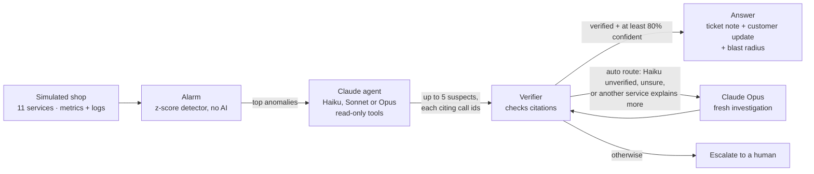
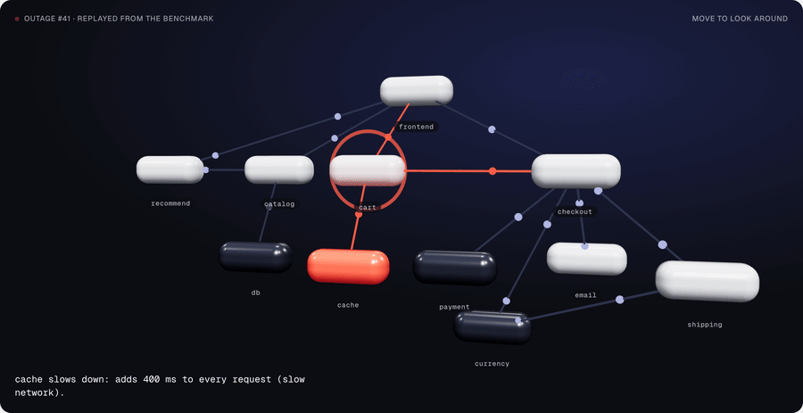

# Sherlog

<p align="center"><a href="https://sherlog-jade.vercel.app"></a></p>

<p align="center">
  <a href="https://sherlog-jade.vercel.app"></a>&nbsp;&nbsp;
  <a href="https://sherlog-jade.vercel.app/console"></a>&nbsp;&nbsp;
  <a href="https://sherlog-jade.vercel.app/console#replay/41"></a>
</p>

**When one service breaks, everything that calls it breaks too. Sherlog is an AI on-call investigator that finds the one that broke, and has to prove it.** A Claude agent investigates a simulated shop of 11 microservices with read-only tools (metrics, logs, the call graph) and ranks up to five suspects, each citing the tool calls that back it. Plain code, not a second AI, checks every citation, and a blast-radius check shows whether the answer explains every broken service. Only an answer whose top suspect passes the citation check at 80% confidence or more goes out, with a ticket note for engineers and an update for customers; anything less goes to a human.

It is also a game: lock in your own guess before the agent answers, then see who was right, you, Claude or the classic no-AI ranking. Choose who investigates (Claude Haiku, Sonnet, Opus, or **auto**: Haiku first, Opus only when Haiku's answer doesn't hold up) and switch on **hard mode** for a decoy.

**Try it: [sherlog-jade.vercel.app](https://sherlog-jade.vercel.app).** Scroll the story of one recorded outage, then [break a service in the console](https://sherlog-jade.vercel.app/console) or replay any of the 176 recorded investigations for free.

Built during IceHacks 2026 (submissions close November 15, 2026).

**Contents:** [Results at a glance](#results-at-a-glance) · [How it works](#how-it-works) · [Try it](#try-it) · [Evaluation in detail](#evaluation-in-detail) · [Reproduce](#reproduce) · [Repository layout](#repository-layout) · [Limitations](#limitations)

---

## Results at a glance

**132 outages**, three for every service and fault type (seeds 1000–1131), and **44 hard-mode outages** with a decoy (seeds 2000–2043), none of them looked at while the prompt and tools were built. "Cause first" means the true cause was ranked first *and* accepted by the verifier, whether or not the agent then answered on its own.

<p align="center"></p>

| Method | Normal · cause first | Normal · answered alone | Hard · cause first | Hard · right when it answered | Median cost |
|---|---:|---:|---:|---:|---:|
| No AI: rank services by z-score | 83% [75–88] | – | 66% [51–78] | – | – |
| No AI: robust z-score (median and MAD) | 78% [70–84] | – | 57% [42–70] | – | – |
| Claude Opus 5.5, one prompt, no tools | 100% [97–100] | 107 of 132 | 80% [66–89] | 4 of 4 | $0.020 |
| Sherlog agent on Claude Haiku 5.5 | 100% [97–100] | 129 of 132 | 86% [73–94] | 28 of 33 | $0.0015 |
| Sherlog agent on Claude Sonnet 5.5 | 100% [97–100] | 130 of 132 | 86% [73–94] | 22 of 24 | $0.014 |
| **Sherlog agent on Claude Opus 5.5** | **100% [97–100]** | **132 of 132** | **98% [88–100]** | **29 of 29** | $0.047 |
| **Sherlog auto** (Haiku first, then Opus) | **100% [97–100]** | **132 of 132** | 91% [79–96] | 30 of 34 | **$0.0015** |

Brackets are 95% Wilson intervals; median cost is per normal outage.

- **The agent beats the classic ranking.** On the same 132 outages the Opus agent alone was right in 23 and the no-AI ranking alone in none (exact McNemar test, p = 2.4e-7). In hard mode: 14 against 0 (p = 0.0001).
- **Investigation turns a guess into an answer you can act on.** One prompt with no tools was as accurate on normal outages, but confident enough to answer only 107 of 132, and 4 of 44 hard ones.
- **Opus's answer rate at Haiku prices.** Auto lets Haiku go first and hands over to a fresh Opus investigation only when Haiku's answer doesn't hold up. On normal outages it answers all 132, all correctly (Haiku alone answered 129), for a median $0.0015, calling Opus in 4 of 132. In hard mode it trails Opus: 91% against 98%, and 4 of its 34 answers were wrong.
- **The decoy separates the models.** Haiku answered 5 hard outages wrong and Sonnet 2; Opus never answered wrong, and handed the 15 it wasn't sure about to a human. (Opus was right where Haiku or Sonnet was not in 5 outages and never the reverse: suggestive, but p = 0.06 on 44 outages.)
- **The blast-radius check catches the classic mistake.** On normal outages it flags all 23 of the no-AI ranking's wrong answers and only 1 of the 132 true causes. In hard mode it flags every answer, right or wrong, because the decoy is never explained, so there it cannot tell them apart.

---

## How it works



1. **Detect.** The alarm fires when a metric stays 4σ above its normal level for 15 seconds. It is deliberately not AI, so what the AI adds can be measured on its own.
2. **Investigate.** The agent starts from the top anomalies and works through at most 8 rounds of read-only tools, `get_metric`, `get_logs` and `get_dependencies`, then calls `submit_ranking`: up to five suspects, each with a fault type, one sentence of reasoning, a confidence and the ids (`c0`, `c1`, …) of the tool calls that support it. It is never told what broke.
3. **Verify.** Every tool call records which services its result showed abnormal (z ≥ 3, or at least two warning lines implicating the service). A suspect is accepted only if a call it cites really showed it abnormal. Then the **blast-radius check** asks whether the answer explains the outage: every service that stayed abnormal should be the answer or one of its callers, and only slowness and failures travel to callers, since a busy CPU slows no one down by itself. It does not block an answer: the console shows its result next to the verdict, and on the auto route it can send Haiku's answer to Opus.
4. **Answer, or hand over.** If suspect #1 is verified and at least 80% confident, Sherlog answers and drafts the ticket note for engineers and the customer update. Anything less is escalated to a human; on the auto route, a doubtful Haiku answer goes to a fresh Opus investigation first.

<p align="center"></p>
<p align="center"><em>Outage #41 in the console: the slowdown in <code>cache</code> makes cart, checkout and frontend look broken too. The classic ranking blames <code>cart</code>; the agent names <code>cache</code> and proves it.</em></p>

---

## Try it

**The story page** ([sherlog-jade.vercel.app](https://sherlog-jade.vercel.app)) tells one recorded outage as you scroll. The hero plays it on the shop's call graph in 3D: requests flow from callers to the services they call, the failure travels back up, and the agent's tool calls run until the answer is verified.

<p align="center"></p>

<table>
  <tr>
    <td width="50%"></td>
    <td width="50%"></td>
  </tr>
  <tr>
    <td><em>A wall of red: pick the one that broke, then see which were victims.</em></td>
    <td><em>A pinned stage walks through the alarm, the investigation, the verifier and the verdict.</em></td>
  </tr>
</table>

**The console** ([/console](https://sherlog-jade.vercel.app/console)) is where you break things:

- **Pick a service and a fault** from a fixed menu: +400 ms of network latency, a bad deploy that fails 30% of requests, CPU starved at 97%, or a memory leak.
- **Choose who investigates:** Claude Haiku 5.5, Sonnet 5.5, Opus 5.5, or auto.
- **Choose the difficulty.** Hard mode adds a decoy, a service the fault cannot reach (never the culprit or one of its callers) with a harmless anomaly that starts with the fault (a batch job pinning a CPU, a cache warm-up filling a heap), and callers log 60% fewer complaints.
- **Lock in your guess** on the service map or a telemetry row once the alarm fires, before the agent answers.
- **Watch the flight log:** every tool call and the model's reasoning stream in as they happen.
- **Read the verdict:** the ranked suspects with their verified or rejected badges, the blast radius, the ticket note and the customer update, and the scoreboard: you against the agent against the no-AI ranking.
- **Replay for free:** every Opus agent investigation from the benchmark (#1–#132 normal, H1–H44 hard) replays without spending API credits; the other variants' runs are recorded in [`runs/`](runs). Live runs are limited to 6 an hour per visitor and 200 a day.
- **Evidence:** the benchmark tables for every method on normal and hard outages, the no-logs run and the by-fault breakdown, with intervals and McNemar tests, served from the recorded runs. Every figure, including "right when it answered", is in [`runs/evidence.json`](runs/evidence.json).

---

## Evaluation in detail

**The shop.** [`sim.py`](sim.py) is a seeded model of an online shop: frontend, catalog, cart, checkout, payment and six more, wired by a call graph. Four fault types. Latency and errors flow upward to callers; callers log `rpc payment.Charge failed`, naming the *callee*; a network delay leaves no trace in the broken service's own logs. Telemetry is noisy in different ways, as it is in production: busy services jitter densely, others sit flat with the odd tall spike or drift slowly, quiet services report few fresh samples, error rates are counted from each tick's requests, and heaps saw up and down with garbage collection. How noisy each service is changes from outage to outage. In 1,500 simulated healthy shops (10 minutes each, the last 5 watched by the alarm), 6 raised a false alarm, about 0.4%.

**Why the classic ranking fails.** Ranking services by how far their metrics moved (z-score) is the standard baseline. It breaks when a victim is *quieter* than the cause: if `cart` normally has very steady latency and `cache` is noisy, a slowdown in `cache` makes `cart` look more abnormal than `cache` itself. And it cannot tell a decoy from a cause. The agent follows the call graph and the callers' logs to the unhealthy service that explains everything else.

**Split.** Benchmark seeds (1000–1131 normal, 2000–2043 hard) were kept apart while the prompt and tools were developed. Every outage is reproducible from its seed.

**Scoring.** "Cause first" counts when the true cause is ranked first and accepted by the verifier, whether or not Sherlog then answered on its own; a wrong or rejected top suspect, no submission or a failed run is a miss. "Answered alone" and "right when it answered" report the answer-or-escalate decision separately. Intervals are 95% Wilson intervals. Each method is compared with the z-score ranking by an exact McNemar test on the same outages; Claude variants are not tested against each other.

<details>
<summary><b>Normal benchmark, every method · 132 outages</b></summary>

| Method | Cause first | In top 3 | Answered alone | Right when it answered | Median cost |
|---|---:|---:|---:|---:|---:|
| No AI: z-score ranking | 83% [75–88] | 100% | – | – | – |
| No AI: robust z-score (median and MAD) | 78% [70–84] | 100% | – | – | – |
| Claude Opus 5.5, one prompt, no tools | 100% [97–100] | 100% | 107 of 132 | 100% | $0.020 |
| Sherlog agent on Claude Haiku 5.5 | 100% [97–100] | 100% | 129 of 132 | 100% | $0.0015 |
| Sherlog agent on Claude Sonnet 5.5 | 100% [97–100] | 100% | 130 of 132 | 100% | $0.014 |
| Sherlog agent on Claude Opus 5.5 | 100% [97–100] | 100% | 132 of 132 | 100% | $0.047 |
| Sherlog auto (Opus needed in 4) | 100% [97–100] | 100% | 132 of 132 | 100% | $0.0015 |

By fault type, the no-AI ranking names the cause first in 76% of latency faults, 76% of error faults, 79% of CPU faults and 100% of memory leaks; the Opus agent in 100% of each.

</details>

<details>
<summary><b>Hard mode, every method · 44 outages with a decoy</b></summary>

| Method | Cause first | Answered alone | Right when it answered | Median cost |
|---|---:|---:|---:|---:|
| No AI: z-score ranking | 66% [51–78] | – | – | – |
| No AI: robust z-score (median and MAD) | 57% [42–70] | – | – | – |
| Claude Opus 5.5, one prompt, no tools | 80% [66–89] | 4 of 44 | 100% | $0.023 |
| Sherlog agent on Claude Haiku 5.5 | 86% [73–94] | 33 of 44 | 85% | $0.0023 |
| Sherlog agent on Claude Sonnet 5.5 | 86% [73–94] | 24 of 44 | 92% | $0.016 |
| Sherlog agent on Claude Opus 5.5 | 98% [88–100] | 29 of 44 | 100% | $0.056 |
| Sherlog auto (Opus needed in 12) | 91% [79–96] | 34 of 44 | 88% | $0.0024 |

Against the no-AI ranking, the Opus agent alone was right in 14 hard outages and the ranking alone in none (exact McNemar test, p = 0.0001).

</details>

<p align="center"></p>

**What each step adds.**

- **Reasoning over ranking:** every Claude variant names the cause first more often than the no-AI rankings, which blame a victim in 17–22% of normal outages and are wrong in a third or more of hard ones (34% and 43%), about half the time by naming the decoy.
- **Investigation over one prompt:** the same accuracy on normal outages, and one prompt's top suspects passed the verifier too (citing the alarm's anomaly list), but it was seldom 80% sure. Investigating made the agent confident enough to answer far more outages without a human: 132 against 107 normal, 29 against 4 hard.
- **A bigger model where it counts:** on normal outages Haiku matches Opus at about a thirtieth of the cost; with a decoy, Haiku and Sonnet were sometimes confidently wrong and Opus never was (5 outages to 0 against each, p = 0.06: suggestive on 44 outages, not proof).
- **Logs were not needed on normal outages:** an agent without `get_logs` scored 100% [92–100] on 44 of them.

**When can you trust an answer?** Sherlog answers only when its top suspect passed the verifier and its confidence is at least 80%; everything else is escalated. On normal outages the Opus agent answered all 132, all right. In hard mode it answered 29 of 44, all right, and handed over 15. **The blast-radius check** then tests whether the answer explains the outage. On normal outages 131 of the Opus agent's 132 answers explain every abnormal service through the call graph, and the check flags all 23 wrong answers of the no-AI ranking. In hard mode it flags every answer, the true cause included, because the decoy stays abnormal and the real fault cannot explain it; there it helps only when another service would explain strictly more of the outage, which is the auto route's handoff test. That is why the check informs the answer rather than blocking it.

---

## Reproduce

Requires Python 3.13 and [uv](https://github.com/astral-sh/uv).

```bash
uv venv --python 3.13 && uv pip install -r requirements.txt
cp .env.example .env                                  # then put your Anthropic API key in .env
uv run --env-file .env uvicorn app:app --reload       # http://localhost:8000 (story), /console (break something)
uv pip install pytest && .venv/bin/python -m pytest -q   # 66 tests: simulator, agent loop, verifier, auto route, API
```

Without an API key the console still works with the recorded outages.

**Every number.** Each run, with every tool call and the model's reasoning, is recorded in [`runs/`](runs).

```bash
uv run --env-file .env python bench.py --n 132 --variant agent       # also: one-shot, haiku, sonnet (no-logs was run with --n 44)
uv run --env-file .env python bench.py --n 44 --variant hard-agent   # also: hard-one-shot, hard-haiku, hard-sonnet
uv run python bench.py --report                                      # prints the normal tables and rewrites runs/evidence.json
python scripts/make_figures.py                                       # media/results.svg, from runs/evidence.json
```

**Deploy.** `vercel env add ANTHROPIC_API_KEY production`, then `vercel --prod`; FastAPI in `app.py` is detected automatically. Live runs cost about $0.001–0.12 each (median $0.0015 on Haiku, about $0.05 on Opus) and the built-in rate limit is per server instance, so also set a monthly spend limit on the key.

---

## Repository layout

| Path | What it holds |
|---|---|
| [`sim.py`](sim.py) | The seeded shop: call graph, faults, noise textures, the alarm, hard mode's decoy |
| [`investigate.py`](investigate.py) | The tools, the agent loop, the verifier, the blast-radius check and the auto route |
| [`bench.py`](bench.py) | The benchmark: variants, no-AI baselines, Wilson intervals, McNemar tests, the evidence file |
| [`app.py`](app.py) | FastAPI: the pages, live investigations streamed as server-sent events, replays, rate limits |
| [`static/landing.html`](static/landing.html), [`static/hero3d.js`](static/hero3d.js), [`static/ribbon.js`](static/ribbon.js) | The story page, its 3D call graph, and the scroll ribbon and liquid surface behind it |
| [`static/index.html`](static/index.html) | The console |
| [`static/shared.css`](static/shared.css), [`static/shared.js`](static/shared.js) | Colours, type, motion and helpers shared by both pages |
| [`runs/`](runs) | Every recorded investigation, and `evidence.json`, the tables they add up to |
| [`scripts/make_figures.py`](scripts/make_figures.py), [`media/`](media) | The results chart, drawn from the recorded runs, and the README's images |
| [`test_core.py`](test_core.py) | The tests |

---

## Limitations

- **The telemetry is simulated.** We wrote the simulator, so it is cleaner than production even with its noise: caller logs name the failing callee and there is one real fault at a time. On normal outages every Claude variant scores 100%, so they differ only in cost and in how often they can answer safely; hard mode is what separates them. The no-AI baselines run on exactly the same data, so the comparisons are fair, but the absolute numbers are optimistic.
- **The benchmarks are small.** 132 normal and 44 hard outages; the intervals are shown for that reason, and on 44 outages one miss moves a score by 2.3 points.
- **A decoy is one kind of confusion.** Two faults at once, flapping faults and retry storms are not simulated yet.
- **The rate limiter is in memory,** so it is per server instance.

**Next:** a public benchmark of real outages ([RCAEval](https://github.com/phamquiluan/RCAEval)); harder faults; real telemetry in (Prometheus alerts) and a summary out (Slack).

---

## Built with

Python, FastAPI and the Anthropic Python SDK, with Claude Haiku 5.5, Sonnet 5.5 and Opus 5.5 (tool use, adaptive thinking, strict tool schemas); vanilla JavaScript, canvas and SVG; [three.js](https://threejs.org) (MIT, loaded from jsDelivr) for the 3D call graph, the ribbon and the liquid surface; the [Geist](https://vercel.com/font) fonts (SIL Open Font License); deployed on Vercel. Developed with Claude Code as an AI pair programmer.

## License

Written from scratch during IceHacks 2026. [MIT License](LICENSE).
