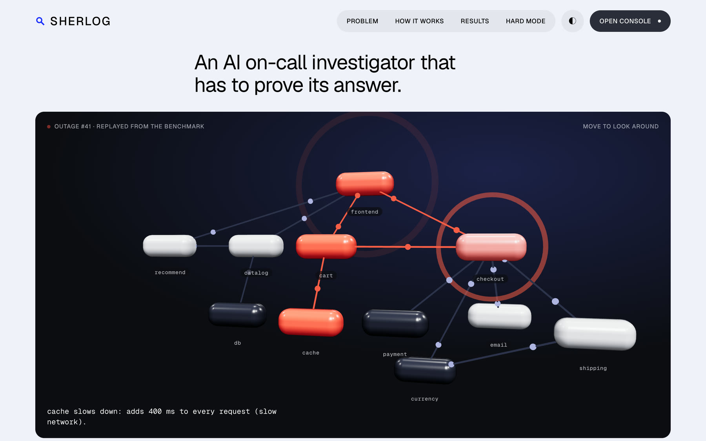
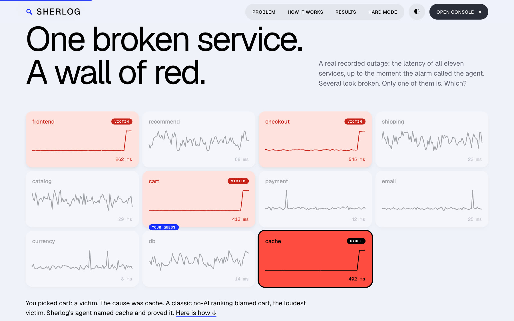
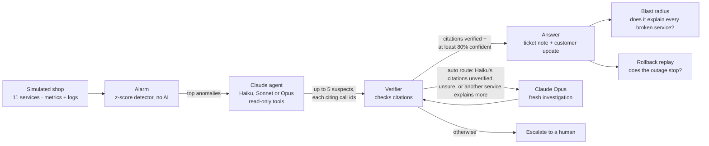
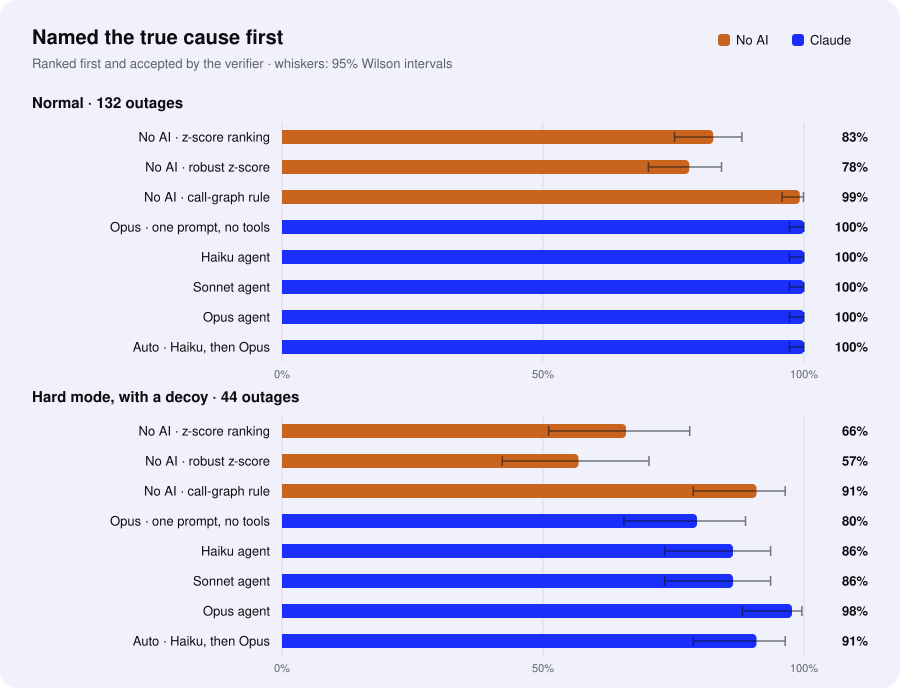

# Sherlog

**When one service breaks, everything that calls it breaks too. Sherlog is an AI on-call investigator that finds the one that broke, and has to prove it**: plain code checks every tool call it cites, and a replay with its answer rolled back shows whether the outage really stops.

<p align="center"><a href="https://sherlog-jade.vercel.app"></a></p>

<p align="center">
  <a href="https://github.com/shaunmortal/sherlog/actions/workflows/tests.yml"></a>
  
  <a href="LICENSE"></a>
</p>

<p align="center">
  <a href="https://sherlog-jade.vercel.app"></a>&nbsp;&nbsp;
  <a href="https://sherlog-jade.vercel.app/console"></a>&nbsp;&nbsp;
  <a href="https://sherlog-jade.vercel.app/status"></a>
</p>

Demo video: VIDEO_URL (2:31)

Built during IceHacks 2026.

**Contents:** [Who it is for](#who-it-is-for) · [Evaluate it in 5 minutes](#evaluate-it-in-5-minutes) · [What's new](#whats-new-here) · [Try it in 30 seconds](#try-it-in-30-seconds) · [How it works](#how-it-works) · [Results](#results) · [Accessibility](#accessibility) · [Reliability](#reliability) · [Bring your own outage](#bring-your-own-outage) · [Reproduce](#reproduce) · [Layout](#repository-layout) · [Limitations](#limitations) · [How it was built](#how-it-was-built)

---

## Who it is for

- **The on-call engineer facing a wall of red**, who needs the one service that broke, the tool calls that show it, and a ticket note, or a clear hand-over when the agent is not sure.
- **Teams deciding whether to trust an AI on-call agent**, who can reuse the verify-then-rollback gate and the benchmark protocol: held-out seeds, a decoy mode, no-AI baselines and paired tests.
- **People practising triage**, through the guess game: you against Claude and the no-AI z-score ranking on the same outage.

## Evaluate it in 5 minutes

| Minute | Open | What you should see |
|---|---|---|
| 0:00–2:31 | The demo video (link above) | The whole loop: an outage, a guess, the investigation, the checks and the rollback. |
| 2:31–3:00 | [`/console#replay/41`](https://sherlog-jade.vercel.app/console#replay/41) | A recorded outage, free, in about 11 s. The z-score ranking blames `cart`; the agent names `cache`, 90% sure, citing calls `c0`, `c1` and `c3`, all verified; rolling `cache` back clears all four broken services. |
| 3:00–3:30 | [`/console#replay/177`](https://sherlog-jade.vercel.app/console#replay/177) (C1 in the Replay tab) | A confident wrong answer the rollback stopped. In hard mode the Haiku agent names `cart`, the decoy, 85% sure, with its citations verified, so it goes out; rolling `cart` back leaves `frontend` abnormal and the alarm on, so the rollback does not prove it. |
| 3:30–4:00 | [Your data](https://sherlog-jade.vercel.app/console#data) → **Use the sample** → **Triage (no AI)** | No key needed. The alarm, the z-score ranking (`cart` first), the robust z-score (`cache` first) and the blast-radius check, which says `cache` would explain more of the outage than `cart`. |
| 4:00–5:00 | A clone of this repository, no key | `pytest -q`: 174 passed and 1 skipped (the browser checks, which need a running server), in about 17 s. `python bench.py --report`: every results table and a fresh [`runs/evidence.json`](runs/evidence.json) from the recorded runs, with no API calls, in about 14 s. |

```bash
uv run --with-requirements requirements.txt --with pytest --with httpx pytest -q
uv run --with-requirements requirements.txt python bench.py --report
```

---

## What's new here

- **Answers must prove themselves.** Every suspect cites the tool calls (`c0`, `c1`, …) behind it, and plain code, not a second AI, checks that each cited call really showed that service abnormal. Only a top suspect with its citations verified, at 80% confidence or more, goes out; everything else goes to a human. A victim is abnormal too, so its citations pass: this check catches citations that do not show what they claim, and the blast-radius check and the rollback replay tell the cause from its victims.
  *In hard mode the Opus agent answered 29 of 44 outages on its own, all right, and handed the other 15 to a human.*
- **Proof by intervention.** After the verdict, Sherlog replays the same outage, with the same noise, and its answer rolled back. Roll back the cause and the slowness and errors stop; roll back a victim or a decoy and they carry on, so a decoy that fools every check that only looks cannot fool this one. This is possible because the shop is simulated, where rolling back the cause is exactly what clears the fault; in production the same idea is a canary rollback, which is noisier.
  *Over the recorded runs of the four single-model methods, it would have caught all 7 wrong hard-mode answers and rejected none of the 83 right ones. The 7 replay for free as C1–C7 in the console.*
- **A hard mode where the models separate.** On normal outages every Claude variant scores 100%, which says nothing. Hard mode adds a decoy: a service the fault cannot reach, with a harmless anomaly that starts with the fault.
  *Opus named the cause first in 43 of 44 and never answered wrong; Haiku answered 5 wrong, Sonnet 2. A no-AI call-graph rule names the cause in 40, but it always answers, so it is wrong in 4.*
- **You vs Claude vs the z-score ranking.** Lock in your guess before the agent answers. The scoreboard shows who was right: you, Claude, or the standard no-AI z-score ranking.
  *The z-score ranking blames a victim in 23 of 132 normal outages; the agent in none. A stronger no-AI rule, the call-graph rule, misses only 1, so on normal outages the AI's edge over it is small: see [Results](#results).*
- **Verifier-gated model routing.** **Auto** lets Claude Haiku go first. A fresh Opus investigation starts only when Haiku's answer fails the verifier, is under 80% sure, or another service would explain more of the outage.
  *It answered all 132 normal outages, all right, for a median $0.0015 each, calling Opus in 4.*

---

## Try it in 30 seconds

1. **Guess.** On the [story page](https://sherlog-jade.vercel.app), scroll to the wall of red and pick the service you think broke. It shows the cause and which ones were only victims.
2. **Break a service.** In the [console](https://sherlog-jade.vercel.app/console), pick a service, a fault and who investigates, press **Break it live**, then lock in your guess on the map while Claude works. Or replay [outage #41](https://sherlog-jade.vercel.app/console#replay/41) for free: the z-score ranking blames `cart`, the agent names `cache`, and rolling `cache` back clears all four broken services.
3. **Bring your own outage.** In the console's **Your data** tab, press **Use the sample**, then **Triage (no AI)**. The alarm, the z-score and robust z-score rankings and the blast-radius check run on it, with no API key. **Investigate with Claude** runs the agent on it.

<table>
  <tr>
    <td width="50%"></td>
    <td width="50%"></td>
  </tr>
  <tr>
    <td><em>A wall of red: pick the one that broke, then see which were victims.</em></td>
    <td><em>A pinned stage walks through the alarm, the investigation, the verifier, the verdict and the rollback.</em></td>
  </tr>
</table>

---

## How it works



1. **Detect.** The alarm fires when a metric stays 4σ above its normal level for 15 seconds. It is deliberately not AI, so what the AI adds can be measured on its own.
2. **Investigate.** The agent starts from the top anomalies and works through at most 8 rounds of read-only tools (`get_metric`, `get_logs`, `get_dependencies`), then submits up to five suspects, each with a fault type, one sentence of reasoning, a confidence and the ids of the tool calls that support it. It is never told what broke.
3. **Verify.** Every tool call records which services its result showed abnormal (z ≥ 3, or at least two warning lines implicating the service). A suspect is accepted only if a call it cites really showed it abnormal. This checks the citations, not the answer: a victim is abnormal too, so its citations pass, and step 5's checks are what tell it from the cause.
4. **Answer, or hand over.** If suspect #1's citations are verified and it is at least 80% confident, Sherlog answers and drafts the ticket note and the customer update. Anything less goes to a human; on the auto route, a doubtful Haiku answer goes to a fresh Opus investigation first.
5. **Check the answer.** The **blast-radius check** asks whether the answer explains every service that stayed abnormal: each must be the answer or one of its callers, and only slowness and failures travel to callers. The **rollback replay** re-runs the outage from its seed with the answer rolled back and reports whether the alarm stops and which services recover. In hard mode the decoy's harmless CPU or memory anomaly can keep the alarm on, so the replay also counts as proof when every latency and error alarm ends. Both results are shown next to the verdict and neither changes it, with one exception: on the auto route, a Haiku answer that another service would explain better goes to Opus first.

<p align="center"></p>
<p align="center"><em>Outage #41 in the console: the slowdown in <code>cache</code> makes cart, checkout and frontend look broken too. The z-score ranking blames <code>cart</code>; the agent names <code>cache</code>, and rolling <code>cache</code> back clears the outage.</em></p>

---

## Results

**132 normal outages**, three for every service and fault type (seeds 1000–1131), and **44 hard-mode outages** with a decoy (seeds 2000–2043). None were looked at while the prompt and tools were built. "Cause first" means the true cause was ranked first *and* its citations were verified. Every figure in the tables is in [`runs/evidence.json`](runs/evidence.json), computed from the recorded runs in [`runs/`](runs).

<p align="center"></p>

| Method | Cause first, normal · hard | Answered alone, normal · hard | Wrong answers, hard | Median cost |
|---|---:|---:|---:|---:|
| No AI: rank services by z-score | 83% · 66% | always | 15 | – |
| No AI: robust z-score (median and MAD) | 78% · 57% | always | 19 | – |
| No AI: call-graph rule | 99% · 91% | always | 4 | – |
| Claude Opus 5.5, one prompt, no tools | 100% · 80% | 107 · 4 | 0 | $0.020 |
| Sherlog agent on Claude Haiku 5.5 | 100% · 86% | 129 · 33 | 5 | $0.0015 |
| Sherlog agent on Claude Sonnet 5.5 | 100% · 86% | 130 · 24 | 2 | $0.014 |
| **Sherlog agent on Claude Opus 5.5** | **100% · 98%** | **132 · 29** | **0** | $0.047 |
| **Sherlog auto** (Haiku first, then Opus) | 100% · 91% | 132 · 34 | 4 | **$0.0015** |

No Claude method answered a normal outage wrong. The no-AI methods always name a service, so every miss is a wrong answer: on normal outages, 23 for the z-score ranking, 29 for the robust z-score and 1 for the call-graph rule. Median cost is per normal outage. Auto was not run on its own: its rows apply the live route's handoff rule to the recorded Haiku and Opus runs on the same outages, paying for both when Haiku hands over.

- **The agent beats the z-score ranking.** The Opus agent was right where the z-score ranking was wrong in 23 normal and 14 hard outages, never the reverse (exact McNemar test, p = 2.4e-7 and p = 0.0001).
- **A no-AI call-graph rule comes close.** Among the services that stayed abnormal, it names the one that explains the most of the others through the call graph (each must be it or one of its callers), ties broken by z-score: the blast-radius check's reasoning, with no logs and no AI. It names the cause first in 131 of 132 normal and 40 of 44 hard outages. The Opus agent was right where the rule was wrong in 1 normal and 3 hard outages, never the reverse, which on benchmarks this size could be chance (exact McNemar test, p = 1.0 and p = 0.25). In hard mode the Haiku and Sonnet agents (86%) and one-prompt Opus (80%) score below the rule, and auto (91%) ties it.
- **What the AI adds over the rule.** The rule always answers, so in hard mode it was wrong in 4 of 44, each time naming the decoy. The Opus agent answered 29 on its own, all right, and handed the other 15 to a human, each with a ticket note. Every answer also comes with reasoning a person can read, citations code can check, and a customer update. The rollback replay is not AI and checks the rule's answers too: see the gate what-if below.
- **Investigation turns a guess into an answer.** One prompt with no tools was as accurate on normal outages, but sure enough to answer only 107 of 132, and 4 of 44 hard ones.
- **The blast-radius check catches the z-score ranking's mistake.** On normal outages it flags all 23 of the z-score ranking's wrong answers and only 1 of the Opus agent's 132 right ones. In hard mode it flags all 29 of the Opus agent's answers, because the decoy is never explained.

### The rollback replay, over the recorded answers

The rollback test was applied offline to every recorded answer: each outage was re-simulated from its seed with the answer rolled back. No API calls; `python bench.py --report` recomputes it. In the simulator, rolling back the true cause is exactly what clears the fault, so the rollback and rollback-gate numbers below show how the gate behaves, not how accurate it would be in the field; in production the equivalent is a canary rollback, which is noisier.

| Method | Normal: answers · proven | Hard: answers · proven | Hard: wrong answers · caught | Right answers rejected |
|---|---:|---:|---:|---:|
| Claude Opus 5.5, one prompt | 107 · 107 | 4 · 4 | 0 · 0 | 0 |
| Agent on Haiku 5.5 | 129 · 129 | 33 · 28 | 5 · 5 | 0 |
| Agent on Sonnet 5.5 | 130 · 130 | 24 · 22 | 2 · 2 | 0 |
| Agent on Opus 5.5 | 132 · 132 | 29 · 29 | 0 · 0 | 0 |
| Auto | 132 · 132 | 34 · 30 | 4 · 4 | 0 |

The 7 wrong answers it caught, 5 from Haiku and 2 from Sonnet, replay for free as C1–C7 in the console's Replay tab, listed by [`GET /api/replays`](https://sherlog-jade.vercel.app/api/replays) as `caught` (numbers 177 to 183). Each went out with its citations verified and 80% to 88% confidence, each named the decoy, and in each the rollback leaves the alarm on.

### What if the rollback were the answer gate? (offline what-if)

Today Sherlog answers when its top suspect's citations are verified and it is at least 80% confident. This **what-if over the recorded verdicts** asks what would happen if it answered whenever the rollback proves the top suspect, its citations verified, whatever its confidence. Hard mode, 44 outages, answered · right:

| Method | Today: 80% confidence gate | Rollback gate | Either gate |
|---|---:|---:|---:|
| Claude Opus 5.5, one prompt | 4 · 4 | 34 · 34 | 34 · 34 |
| Agent on Haiku 5.5 | 33 · 28 | 37 · 37 | 42 · 37 |
| Agent on Sonnet 5.5 | 24 · 22 | 37 · 37 | 39 · 37 |
| Agent on Opus 5.5 | 29 · 29 | 42 · 42 | 42 · 42 |

With the rollback as the gate, no method answers wrong in the simulator, and Opus answers 42 hard outages instead of 29. Adding it to today's gate does not remove a wrong answer, because those answers were confident. On normal outages the rollback gate answers all 132, all right, for every method here. Auto is left out: its handoff to Opus itself depends on the confidence gate. The rollback gate does not need the AI: applied to the no-AI call-graph rule's first pick on the same seeds, it would answer 131 of 132 normal and 39 of 44 hard outages, all right, against the Opus agent's 132 and 42 (computed with `investigate.graph_ranking` and `investigate.rollback_check`; not part of `bench.py --report`). **The live product still uses the confidence gate** and shows the rollback result as extra evidence.

<details>
<summary><b>Normal benchmark, every method, with intervals · 132 outages</b></summary>

| Method | Cause first | In top 3 | Answered alone | Right when it answered | Median cost |
|---|---:|---:|---:|---:|---:|
| No AI: z-score ranking | 83% [75–88] | 100% | always | 83% | – |
| No AI: robust z-score (median and MAD) | 78% [70–84] | 100% | always | 78% | – |
| No AI: call-graph rule | 99% [96–100] | 100% | always | 99% | – |
| Claude Opus 5.5, one prompt, no tools | 100% [97–100] | 100% | 107 of 132 | 100% | $0.020 |
| Sherlog agent on Claude Haiku 5.5 | 100% [97–100] | 100% | 129 of 132 | 100% | $0.0015 |
| Sherlog agent on Claude Sonnet 5.5 | 100% [97–100] | 100% | 130 of 132 | 100% | $0.014 |
| Sherlog agent on Claude Opus 5.5 | 100% [97–100] | 100% | 132 of 132 | 100% | $0.047 |
| Sherlog auto (Opus needed in 4) | 100% [97–100] | 100% | 132 of 132 | 100% | $0.0015 |

Brackets are 95% Wilson intervals. By fault type, the z-score ranking names the cause first in 76% of latency faults, 76% of error faults, 79% of CPU faults and 100% of memory leaks; the Opus agent in 100% of each. An agent without `get_logs` scored 100% [92–100] on 44 normal outages, where the call-graph rule scored 98%. Every Claude method was right in the call-graph rule's one normal miss and never the reverse (exact McNemar p = 1.0).

</details>

<details>
<summary><b>Hard mode, every method, with intervals · 44 outages with a decoy</b></summary>

| Method | Cause first | Answered alone | Right when it answered | Median cost |
|---|---:|---:|---:|---:|
| No AI: z-score ranking | 66% [51–78] | always | 66% | – |
| No AI: robust z-score (median and MAD) | 57% [42–70] | always | 57% | – |
| No AI: call-graph rule | 91% [79–96] | always | 91% | – |
| Claude Opus 5.5, one prompt, no tools | 80% [66–89] | 4 of 44 | 100% | $0.023 |
| Sherlog agent on Claude Haiku 5.5 | 86% [73–94] | 33 of 44 | 85% | $0.0023 |
| Sherlog agent on Claude Sonnet 5.5 | 86% [73–94] | 24 of 44 | 92% | $0.016 |
| Sherlog agent on Claude Opus 5.5 | 98% [88–100] | 29 of 44 | 100% | $0.056 |
| Sherlog auto (Opus needed in 12) | 91% [79–96] | 34 of 44 | 88% | $0.0024 |

The z-score ranking's 15 misses name the decoy 7 times; the call-graph rule's 4 misses all name it. Against the call-graph rule, paired outage by outage (only the method right · only the rule right, exact McNemar p): one-prompt Opus 0 · 5, p = 0.06; Haiku agent 2 · 4, p = 0.69; Sonnet agent 0 · 2, p = 0.5; Opus agent 3 · 0, p = 0.25; auto 2 · 2, p = 1.0. Opus was right where Haiku or Sonnet was not in 5 outages each, and never the reverse: suggestive, but p = 0.06 on 44 outages.

<p align="center"></p>

</details>

<details>
<summary><b>How the benchmark works</b></summary>

**The shop.** [`sim.py`](sim.py) is a seeded model of an online shop: frontend, catalog, cart, checkout, payment and six more, wired by a call graph. Four faults: +400 ms of network latency, a bad deploy that fails 30% of requests, CPU starved at 97%, and a memory leak. Latency and errors flow up to callers; callers log `rpc payment.Charge failed`, naming the *callee*; a network delay leaves no trace in the broken service's own logs. Each service gets its own kind and amount of noise (dense jitter, flat lines with tall spikes, slow drift, sparse samples, garbage-collection sawtooths), and it changes from outage to outage. In 1,500 simulated healthy shops, 6 raised a false alarm (0.4%).

**Hard mode** adds the decoy (never the culprit or one of its callers; a batch job pinning a CPU, or a cache warm-up filling a heap) and callers log 60% fewer complaints.

**Why the z-score ranking fails.** Ranking services by how far their metrics moved (z-score) is the standard baseline. It breaks when a victim is *quieter* than the cause: if `cart` normally has very steady latency and `cache` is noisy, a slowdown in `cache` makes `cart` look more abnormal than `cache` itself. It also cannot tell a decoy from a cause. The agent follows the call graph and the callers' logs instead.

**Where the call-graph rule fails.** The rule ([`investigate.graph_ranking`](investigate.py)) fixes the quiet victim, because a victim explains fewer of the broken services than its cause. It fails when no caller of the cause stays abnormal: then the cause explains only itself, as the decoy does, and the decoy wins the tie when its z-score is higher. All 4 of its hard-mode misses are this case.

**Scoring.** A wrong or rejected top suspect, no submission or a failed run is a miss. "Answered alone" and "right when it answered" report the answer-or-escalate decision separately. Each method is compared with the z-score ranking and with the call-graph rule on the same outages by an exact McNemar test; Claude variants are compared with each other only once, Opus against Haiku and Sonnet in hard mode, by the same test. Every outage is reproducible from its seed.

</details>

---

## Accessibility

The story page, the console and the status page were built to WCAG 2.2 AA.

**What was done**

- **Keyboard.** Every control works from the keyboard. Every page has a skip link. The service, fault, model and difficulty pickers are radio groups, and the console's views are tabs, both moved with the arrow keys. Guessing works from the keyboard on the story page's cards and the console's map and telemetry rows.
- **Screen readers.** Each tool call, the verdict, the rollback result, the auto handoff, the scoreboard and the triage result are announced through a polite live region. The alarm chart, the confidence bars and the 3D shop have text alternatives, and each telemetry row reads out its metric, value and health.
- **Seeing.** Text contrast meets AA in both the light and the dark theme. The theme button says which theme it switches to. Pointer targets meet the WCAG 2.2 minimum target size.
- **Motion.** The pages follow the reduced-motion setting. The story page has a **Pause motion** button for the 3D shop, its captions, the marquee and the looping hints, and the console's telemetry has a **Pause** button.

**How it was measured**

- **axe-core 4.10.2**, with the WCAG 2.0, 2.1 and 2.2 A and AA rules plus best practices: **0 violations** on `/`, `/console` and `/status`, in light and dark, at 1440×900 and 390×844. The story page was also checked scrolled through, at the bottom and after a guess. The console was checked idle, on the replay list, after a replay's verdict, on the Evidence view and after triaging the sample in Your data.
- **Lighthouse accessibility: 100** on the story page, the console and the status page, with its mobile and desktop settings.

**Not covered:** forced-colors (high contrast) mode was not tested, and no one who relies on a screen reader or other assistive technology has tested the pages. Automated checks find only some kinds of barrier.

---

## Reliability

- **Status.** [`/status`](https://sherlog-jade.vercel.app/status) shows whether live investigations are on, how many recorded outages can be replayed, today's live runs against the daily limit, and the deployed version. [`GET /api/health`](https://sherlog-jade.vercel.app/api/health) returns the same as JSON. It makes no API calls and shows no secrets.
- **Recorded outages always work.** All 183 recorded investigations replay with no API key, so the demo still works when live mode is off or the day's live runs are used up: the Opus agent's 176 (132 normal, 44 hard) and the 7 wrong hard-mode answers the rollback caught.
- **Uptime.** Every page and `/api/health` answer `HEAD` as well as `GET`, because uptime monitors send `HEAD`. A scheduled workflow, [`uptime.yml`](.github/workflows/uptime.yml), checks the live health endpoint both ways every 30 minutes.
- **API reference.** [`/docs`](https://sherlog-jade.vercel.app/docs) describes every route, generated from `app.py`.
- **Pinned dependencies.** [`requirements.txt`](requirements.txt) pins the exact versions the tests pass with.
- **Link previews.** All three pages carry a share preview image, [`static/og.jpg`](static/og.jpg).
- **Clear errors, never a hang.** Every live failure ends the stream with a reason the console shows: a missing or invalid key, a model the key cannot use, the API's rate limit, a timeout, no connection, an API error. The verdict then goes to a human. Each model call gives up after 120 s, with 1 retry.
- **Limits.** Live runs are limited to 6 an hour per visitor and 200 a day. Over the limit you get a 429, and with live mode off a 503, each saying what to try instead. A bad upload gets a 422 that names the field; a body over 2 MB gets a 413.
- **Tests.** 174 pytest tests run in CI on every push and pull request:
  - 117 in [`test_core.py`](test_core.py): the simulator, the agent loop against a scripted fake model, the verifier, the blast radius, the rollback, the auto route and the call-graph rule
  - 32 in [`tests/test_api.py`](tests/test_api.py): every route and every failure path of a live run, `HEAD` answers, the API reference, the preview image and tags, replay numbering and the caught replays
  - 25 in [`tests/test_byo.py`](tests/test_byo.py): the upload format, triage and the converter

  Eleven browser end-to-end checks in [`tests/test_e2e.py`](tests/test_e2e.py) run against a running server: the story page loads with no console errors, a guess reveals the cause, its sections wait for a person to scroll to them but not for an automated screenshot (two checks), the console plays a recorded outage to its verdict, the first screen's button replays outage #41 with precise check labels and hands keyboard focus to the flight log, the phone's jump link lands focus on the verdict, a caught replay shows the rollback disproving its answer, triaging the sample afterwards replaces that outage on screen, even while paused, and a triage started from the keyboard keeps focus on its button.

---

## Bring your own outage

Real telemetry, in the same shape as the shop: 10 minutes of the 4 metrics for 11 services, each mapped onto the shop's names by the job it does, plus optional log lines. `POST /api/triage` runs the alarm, the z-score and robust z-score rankings and the blast-radius check, with no AI and no key. `POST /api/investigate` runs the agent and streams the same events as a live break, without the truth reveal, since nobody knows the culprit. `GET /api/sample-incident` gives a sample to start from, and [`scripts/prom_to_sherlog.py`](scripts/prom_to_sherlog.py) converts Prometheus range queries. Format, mapping, checks and limits: [docs/bring-your-own.md](docs/bring-your-own.md).

---

## Reproduce

Requires Python 3.12 or newer (CI runs 3.12) and uv.

```bash
uv venv --python 3.13 && uv pip install -r requirements.txt
cp .env.example .env                                  # then put your Anthropic API key in .env
uv run --env-file .env uvicorn app:app --reload       # http://localhost:8000 (story), /console, /status
uv run --with-requirements requirements.txt --with pytest --with httpx pytest -q   # 174 tests
```

Without an API key everything except live runs works: replays, the Evidence view, triage.

**Browser checks** (needs Chrome): start the server, then `SHERLOG_E2E_URL=http://127.0.0.1:8000 uv run --with-requirements requirements.txt --with pytest --with httpx --with playwright pytest -q tests/test_e2e.py`.

**Every number.** Each run, with every tool call and the model's reasoning, is recorded in [`runs/`](runs).

```bash
uv run --env-file .env python bench.py --n 132 --variant agent       # also: one-shot, haiku, sonnet (no-logs was run with --n 44)
uv run --env-file .env python bench.py --n 44 --variant hard-agent   # also: hard-one-shot, hard-haiku, hard-sonnet
uv run python bench.py --report      # the tables, the rollback what-ifs, and a fresh runs/evidence.json
python scripts/make_figures.py       # media/results.svg, from runs/evidence.json
```

**Deploy.** `vercel env add ANTHROPIC_API_KEY production`, then `vercel --prod`; FastAPI in `app.py` is detected automatically. A recorded run cost between $0.0009 and $0.12 (median $0.0015 on Haiku, $0.047 on Opus). The rate limit is per server instance, so also set a monthly spend limit on the key.

---

## Repository layout

| Path | What it holds |
|---|---|
| [`sim.py`](sim.py) | The seeded shop: call graph, faults, noise, the alarm, hard mode's decoy, and rollbacks |
| [`investigate.py`](investigate.py) | The tools, the agent loop, the verifier, the blast-radius check, the call-graph rule, the rollback check and the auto route |
| [`bench.py`](bench.py) | The benchmark: variants, no-AI baselines, Wilson intervals, McNemar tests, the rollback what-ifs, the evidence file |
| [`byo.py`](byo.py) | Bring your own outage: the `sherlog-incident/1` format, its checks, triage and the sample |
| [`app.py`](app.py) | FastAPI: the pages, live investigations as server-sent events, replays, uploads, health, rate limits |
| [`static/landing.html`](static/landing.html), [`static/hero3d.js`](static/hero3d.js), [`static/ribbon.js`](static/ribbon.js) | The story page, its 3D call graph, and the scroll ribbon and liquid surface behind it |
| [`static/index.html`](static/index.html) | The console |
| [`static/status.html`](static/status.html) | The status page |
| [`static/shared.css`](static/shared.css), [`static/shared.js`](static/shared.js) | Colours, type, motion, theme and accessibility helpers shared by the pages |
| [`runs/`](runs) | Every recorded investigation, and `evidence.json`, the tables they add up to |
| [`docs/bring-your-own.md`](docs/bring-your-own.md), [`scripts/prom_to_sherlog.py`](scripts/prom_to_sherlog.py) | The upload format and the Prometheus converter |
| [`scripts/make_figures.py`](scripts/make_figures.py), [`media/`](media) | The results chart, drawn from the recorded runs, and the README's images |
| [`test_core.py`](test_core.py), [`tests/`](tests), [`.github/workflows/`](.github/workflows) | The tests, the CI workflow and the uptime check |

---

## Limitations

- **The telemetry is simulated.** We wrote the simulator, so it is cleaner than production even with its noise: caller logs name the failing callee and there is one real fault at a time. The no-AI baselines run on exactly the same data, so the comparisons are fair, but the absolute numbers are optimistic.
- **The benchmarks are small.** 132 normal and 44 hard outages; on 44 outages one miss moves a score by 2.3 points, which is why the intervals are shown.
- **A decoy is one kind of confusion.** Two faults at once, flapping faults and retry storms are not simulated.
- **The AI's accuracy edge over a good rule is small.** Against the no-AI call-graph rule, the Opus agent was right in 1 more normal and 3 more hard outages, which is not significant on benchmarks this size. Its clearer gains are handing an outage to a human when unsure and explanations a person can check.
- **The rollback proof needs the simulator.** It replays an outage from its seed, so uploaded telemetry gets no rollback test. In the simulator, rolling back the true cause is exactly what clears the fault, so its numbers measure the gate, not field accuracy. In production it would be a canary rollback, which is noisier and which Sherlog does not perform. Over the 176 benchmark outages, rolling back a service other than the cause never counted as proof (0 of 1,760), but rolling back the cause failed once: in hard seed 2031, checkout's latency noise crossed the alarm line a tick before the fault began, and the replay keeps that noise (computed with `investigate.rollback_check`). Every Claude method handed that outage to a human, so no recorded answer met it, and the rollback-gate what-if escalates it too, though each named the cause first.
- **The rollback gate is a what-if.** It was computed offline over recorded runs; live answers still go through the confidence gate.
- **Uploads must fit the shop.** The same 11-service shape, these 4 metrics, one 10-minute window at 5 s, no traces. Nothing scores an uploaded answer, because nobody knows the culprit.
- **The rate limiter is in memory,** so it is per server instance.

**Next:** a public benchmark of real outages; harder faults; alerts in directly instead of an export, and a summary out to the team's chat.

---

## How it was built

A dated log from what the repository shows: local file timestamps and `git log --reverse --format='%ad %s' --date=iso`, all in IST (UTC+5:30). The first public push came after the first working version, so the git history starts on Nov 14 with the app already working.

| When (IST) | What it added |
|---|---|
| Nov 14, 04:21 | The project starts: `.env.example` and the Python environment are created, the first test run follows at 04:24 and the license at 04:35. |
| Nov 14, 09:03–09:16 | The normal benchmark is recorded: the Opus agent, one-prompt Opus, the Haiku and Sonnet agents and the agent without logs (`runs/bench*.jsonl`). |
| Nov 14, 09:21–09:24 | The hard-mode benchmark is recorded: the Opus, Haiku and Sonnet agents and one-prompt Opus (`runs/bench-hard-*.jsonl`). |
| Nov 14, 17:42 | First commit, pushed within a minute: the simulator, the agent, the verifier, the benchmark with its nine recorded run files, the console, the story page and the core tests. The deploy was linked at 17:43, and the README's images are dated 17:53 to 18:02. |
| Nov 14, 17:46–18:03 | The live demo links and a README rebuilt around the results. |
| Nov 15, 00:43–00:54 | The story page's scroll ribbon. |
| Nov 15, 01:41–02:04 | Bring your own outage and its converter; the status page, `/api/health` and explicit live-run failures; route and failure-path tests and CI; the rollback replay; WCAG 2.2 AA on the console and the story page. |
| Nov 15, 02:21–02:45 | The rollback-as-gate what-if; the rollback shown on the story page and in the console; the Your data tab. |
| Nov 15, 03:16–04:58 | The docs lead with what is new; fixes to triage, upload errors, keyboard focus and touch targets; corrected test counts and claims; CI actions upgraded. |
| Nov 15, 05:54–06:19 | The no-AI call-graph rule; replays of the wrong answers the rollback caught; `HEAD` answers, the `/docs` reference, pinned dependencies, the link preview image and the uptime check; the console's first screen leads with replay #41 and hard mode, the story page's hero links to replay #41, and both label each check precisely. |

## Built with

Python, FastAPI and the Anthropic Python SDK, with Claude Haiku 5.5, Sonnet 5.5 and Opus 5.5 (tool use, adaptive thinking, strict tool schemas); vanilla JavaScript, canvas and SVG; three.js (MIT) for the 3D call graph, the ribbon and the liquid surface; the Geist and Geist Mono fonts (SIL Open Font License); pytest, Playwright and axe-core for the tests and audits; deployed on Vercel. Developed with Claude Code as an AI pair programmer.

**AI use.** Claude Code wrote and tested code under our direction, several features at once in separate agent worktrees, which the `merge:` commits in the history join back together. Claude Haiku 5.5, Sonnet 5.5 and Opus 5.5 power the investigator, and every recorded investigation in [`runs/`](runs) is theirs. The verifier, the blast-radius check, the call-graph rule and the rollback check are plain code, with no AI.

## License

Written from scratch during IceHacks 2026. [MIT License](LICENSE).
