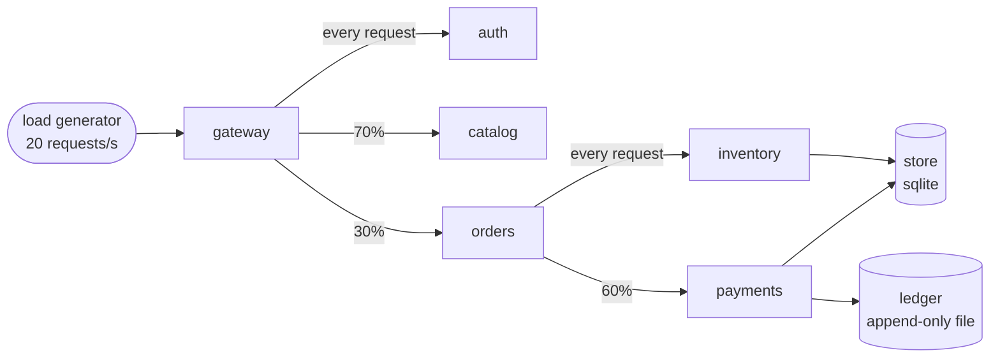

# Sherlog on a real running system

Everything else Sherlog measures comes from a simulated shop, and its rollback proof holds by construction
there: re-simulating an outage without its fault is exactly what clears it. This page is the counterpart on a
real system. Eight services run as separate OS processes on one laptop. They call each other over real HTTP and
take real load. We inject real faults into them: sleeps, raised exceptions, busy threads and leaked memory. A
collector writes Sherlog's upload format from what it measures, and Sherlog investigates that document through
the same code path as `POST /api/investigate`. The rollback is real too: the system keeps running after the
window, we remove the fault from the service the agent named, and 2 more minutes of telemetry decide whether
the alarm stops.

## Results

30 real outages, 20 normal and 10 hard, recorded on 15 November 2026 (`runs/real/outages.jsonl`, the documents
in `runs/real/docs/`). `python -m testbed.report` prints the tables below from those records. The
alarm fired after the fault began in all 30 outages, a median of 10 s after it. It never fired before the
fault, and it never stayed silent.

**Cause first** (the method's first pick is the culprit; for the agent, its top cause is also verified), with
95% Wilson intervals:

| Method | Normal (20) | Hard (10) | All (30) |
|---|---:|---:|---:|
| No-AI: z-score ranking | 17/20 = 85% [64%, 95%] | 4/10 = 40% [17%, 69%] | 21/30 = 70% [52%, 83%] |
| No-AI: robust z-score ranking | 15/20 = 75% [53%, 89%] | 3/10 = 30% [11%, 60%] | 18/30 = 60% [42%, 75%] |
| No-AI: call-graph rule | 20/20 = 100% [84%, 100%] | 9/10 = 90% [60%, 98%] | 29/30 = 97% [83%, 99%] |
| Sherlog auto: Haiku first, Opus if its answer does not stand | 20/20 = 100% [84%, 100%] | 8/10 = 80% [49%, 94%] | 28/30 = 93% [79%, 98%] |
| Sherlog agent on Opus | 20/20 = 100% [84%, 100%] | 8/10 = 80% [49%, 94%] | 28/30 = 93% [79%, 98%] |

What the agent told the on-call engineer:

| Agent | Outages | Answered | Right | Wrong | Escalated | Mean cost |
|---|---:|---:|---:|---:|---:|---:|
| Auto, normal | 20 | 20 | 20 | 0 | 0 | $0.0037 |
| Auto, hard | 10 | 9 | 7 | 2 | 1 | $0.0216 |
| Opus, normal | 20 | 20 | 20 | 0 | 0 | $0.0392 |
| Opus, hard | 10 | 6 | 6 | 0 | 4 | $0.0563 |

**The real rollbacks.** Every service named first by the z-score ranking, the call-graph rule, auto or Opus
was rolled back for real, the culprit last: 39 tests in all.

- Rolling back a service that was not the culprit never stopped the alarm: 0 of 10 such tests counted as
  proof. Every wrong answer that was rolled back was caught: the z-score ranking's 9, the call-graph rule's 1
  and auto's 2. No wrong answer passed.
- Rolling back the true culprit stopped the alarm in 27 of 29 tests (19 of 20 normal, 8 of 9 hard). Both
  failures were memory leaks, and both rejected a right answer:
  - `real-n11` (ledger leaking): after the rollback freed the leak, the process's resident memory took about
    25 s to fall back, under the experiment's memory pressure. The rule judges from 10 s after the rollback,
    so three ticks still read high, and the alarm counted as still on. Measured afterwards with only one
    other copy of the system running, the same rollback gave the memory back in about 5 s.
  - `real-h07` (orders leaking, with a cache warm-up decoy in inventory): the memory took about 30 s to
    fall, and the decoy's memory, still up, kept an alarm on as well. The rule forgives a lingering CPU or
    memory anomaly only when the rollback ends a latency or error alarm, and this leak raised neither. So
    while a memory decoy stays on, no rollback can prove a leak that slows nobody down, under this rule.
- In `real-h03` (catalog leaking, a cache warm-up decoy in payments) every method named payments first, so
  the culprit was never rolled back. The rollback of payments caught that wrong answer.
- When the agent escalated, its top suspect was still rolled back: auto's 1 escalation was proved and was
  the cause; of Opus's 4, 2 were proved and were the cause, and the other 2 (`real-h03`, `real-h07`) were the
  decoy, and the rollback said so.

**The wrong answers.** Three in all, every one on a hard outage where a memory leak met a memory decoy:
the call-graph rule in `real-h03`, and auto in `real-h03` and `real-h07`. Both of auto's came from Haiku: it
answered at 80% confidence, its answer stood, and Opus was never called. Opus on its own escalated both
outages, with the same wrong suspect on top. The real rollback caught all three.

**What this says.** What the agent added on this system was judgement about its own answer. Opus never gave a wrong answer (0 of 26), and escalated 4 hard outages
instead, 2 of them with the right suspect on top. Auto was cheap ($0.0037 per normal outage). The z-score rankings, which pick the loudest service, fell to 40% and 30% on hard outages:
they blame a caller or the decoy. The real rollback caught every wrong answer that was rolled back, and
rejected two right ones: both memory leaks whose freed memory came back more slowly than the 10 s settle
window, one of them with a memory decoy still on.

**Spend.** $1.64 for the 30 outages, both routes on every outage ($0.055 per outage), and $0.055 more for the
Prometheus outage below: $1.69 in all, under the $6 cap. Every run is in `runs/real/spend.jsonl`.

**How it ran.** The first 3 outages ran with three copies of the system in parallel. That run was cut short
when the editor running it restarted, and its shutdown then crashed: macOS refuses (EPERM) to signal a process
group whose leader has exited but not been reaped, and the teardown did not expect it. The fix and its test
are in `testbed/run.py` and `tests/test_testbed.py`. The other 27 resumed from the records, two copies at a
time, to spare the 8 GB laptop's memory. From then on the memory leak was capped at 200 MB, not 300; none of
the first 3 outages was a leak.

## The system



The topology differs from the simulated shop's: 8 services, 2 of them on disk, and a shared store that two
callers depend on.

| service | RPC | its own work |
|---|---|---|
| gateway | `Route` | routes each request, calls its callees one after another |
| auth | `Verify` | 50 rounds of HMAC-SHA256 on a token |
| catalog | `ListProducts` | builds, sorts and serializes 40 products |
| orders | `PlaceOrder` | calls inventory, then payments |
| inventory | `Reserve` | calls store |
| payments | `Charge` | calls store, then ledger |
| store | `Query` | a real sqlite database (WAL mode): `UPDATE` a stock row, or `INSERT` a charge |
| ledger | `Append` | appends a line to a file |

Each service is a stdlib `ThreadingHTTPServer` in its own process (`testbed/service.py`), on its own port.
Each caller keeps keep-alive connections to its callees, with a 2 s timeout per call. A failed call fails the
request (502), and the caller logs a WARN naming the callee and its RPC (`rpc store.Query failed: HTTP 500`).
A call slower than 250 ms gets a WARN too (`rpc inventory.Reserve slow: 612 ms (threshold 250 ms)`). Each kind
of complaint is logged at most once per 5 s, as log throttling does. Every service also writes a stats line
each minute, and has a memory watchdog: it warns once the process has grown 64 MB and is still growing. The
load generator (`testbed/load.py`) sends 20 requests a second to the gateway, on schedule, over 32 keep-alive
connections.

## Telemetry

Every 5 s (`sim.TICK_SECONDS`) the collector (`testbed/run.py`) takes one reading per service:

- **latency_ms**: the mean server-side time of the requests that finished in that tick, from cumulative
  counters the service exposes on `GET /_stats`
- **error_rate**: the share of those requests answered with a 5xx
- **cpu_pct**: CPU time of the service's process tree over the tick, as a share of one core (the OS's numbers,
  read with psutil). A decoy's batch-job child process counts, as it would in a container. Capped at 100.
- **memory_mb**: resident memory of the process tree

The collector keeps exactly 120 ticks (10 minutes, `sim.WINDOW_TICKS`). It turns them and the services' log
files into a `sherlog-incident/1` document with the testbed's own `calls` and `rpc`, and checks it with the
same strict validation as `POST /api/triage`. A missing reading (no request finished in a tick, or a scrape
failed) holds the reading before it; each record counts them (`filled_readings`). The truth (culprit, fault,
onset tick, decoy) is stored in the record, never in the document. The documents are in `runs/real/docs/`,
named `real-n00` to `real-h09`, names that give nothing away.

## Faults

Each outage starts the services fresh, warms them up for 30 s, and injects the fault at a seeded random tick
in `sim.ONSET_RANGE` (70 to 90) through the service's `POST /_control`. The plan is seeded
(`testbed/outage.py`). Faults take turns, so 20 normal outages hold 5 of each. Each fault visits the
services in its own seeded order.

| fault | what really happens in the service |
|---|---|
| latency | every request sleeps 400 ms more |
| errors | 30% of requests raise a real exception (`KeyError: 'request_id'`, `IndexError`, `ValueError`), logged as ERROR and answered 500 |
| cpu | 3 busy-loop threads inside the process fight its request threads for the interpreter lock |
| memory | the process leaks 6 MB of random bytes every 5 s (up to 200 MB, to spare the 8 GB laptop), still referenced and read, so the OS keeps it resident |

**Hard mode** adds a decoy at the same time (0 to 2 ticks after the fault), as the simulator does: a harmless
anomaly in a service the fault cannot reach (not the culprit, nor anything that calls it). Each hard outage
draws a CPU batch job with probability 0.6, and got one in 3 of the 10: a child process that burns 80 to 95%
of a core of its own, so it slows no request down. The other 7 got a cache warm-up that loads 40 to 60 MB and
holds it. Each decoy logs its own
honest INFO line (`nightly batch job running: reindexing, worker pool busy`), as the simulator's decoy does.
Unlike the simulator, hard mode here does not cut down the callers' complaints.

## What runs on each outage

1. **The no-AI checks** on the document: `byo.triage` (the alarm, the z-score and robust z-score rankings,
   the blast radius) and `investigate.graph_ranking` (the call-graph rule).
2. **The agent, live**, on both routes at once: **auto** (Haiku first, Opus only when Haiku's answer does not
   stand) and **Opus** on its own. It runs through the path `POST /api/investigate` uses: the same request model,
   the same client settings and model mapping, `investigate.incident_events`, the truth event dropped and the
   blast radius added. Only the HTTP layer and the per-visitor limit are skipped. The system keeps running, fault
   and all, while the agent works. A spend cap holds back each run's worst case before it starts and stops live
   runs before the cap. Every run's cost goes to `runs/real/spend.jsonl` as soon as it finishes.
3. **The real rollback.** The services named first by auto, by Opus (whether the agent answered or escalated),
   by the call-graph rule and by the z-score ranking are rolled back one at a time. "Rolling back" removes that
   service's fault and its decoy, if it has either, through `POST /_control`, as rolling it back to the previous
   version would. A service with neither has nothing to roll back, and nothing changes. After each rollback the
   collector records 24 more ticks (2 minutes). The alarm rule decides, against the window's own pre-fault
   baseline: a metric `sim.ALARM_Z` (4) standard deviations above normal for `sim.ALARM_SUSTAIN_TICKS` (3) ticks
   in a row means the alarm is still on. The first 2 ticks (10 s) are not judged, while requests already in
   flight finish. As in `investigate.rollback_check`, the rollback also proves the answer when every latency and
   error alarm ends but a CPU or memory anomaly that slows nobody down stays on. The culprit is always tested
   last, so every other suspect is tested with the fault still on. A rolled-back decoy is restored before the
   next test.

## Run it

One command, on macOS or Linux, from the repository root. A live run needs `ANTHROPIC_API_KEY` in `.env`:

```sh
uv run --env-file .env --with-requirements requirements.txt --with psutil python -m testbed.run --live
uv run --with-requirements requirements.txt python -m testbed.report     # the tables above, from the records
uv run --env-file .env --with-requirements requirements.txt --with psutil python -m testbed.prom --live  # one outage via /metrics
```

Leave out `--live` and `--env-file .env` to run only the no-AI checks and the rollbacks of their answers.
`--normal 20 --hard 10 --beds 2 --cap 6` are the defaults. Each record is appended to
`runs/real/outages.jsonl` the moment its outage finishes. A re-run skips the finished outages and counts the
recorded spend against the cap, so a crash loses at most the outages in progress. A bigger plan extends a
smaller one: `--normal 24 --hard 12` adds 6 new outages to the 30. `psutil` is needed by the testbed only. It
is not in `requirements.txt`, and the unit tests (`tests/test_testbed.py`) start no server and do not need it.

## Plugging it in through Prometheus

A team that already runs Prometheus would not write our collector. It would scrape `/metrics`, query 10
minutes with `step=5s`, and run `scripts/prom_to_sherlog.py` on the answers. We did that for one outage, as far
as this laptop allows.

**What was done.** Every service also answers `GET /metrics` in the Prometheus text format (version 0.0.4):
`testbed_requests_total` and `testbed_request_errors_total` (counters), `testbed_request_duration_seconds` (a
summary: `_sum` and `_count`), and the standard `process_cpu_seconds_total` and `process_resident_memory_bytes`,
over the process and its children. For one outage, `prom-n00` (store, +400 ms per request from tick 83), `python
-m testbed.prom --live` scraped all eight endpoints every 5 s, as a scrape job with a 5 s interval would, and
kept the raw samples. The usual collector recorded the same window of the same running system at the same
time. The samples became `query_range` answers (step 5 s) for these queries:

| Sherlog metric | query |
|---|---|
| `latency_ms` | `1000 * irate(testbed_request_duration_seconds_sum[10s]) / irate(testbed_request_duration_seconds_count[10s])` |
| `error_rate` | `irate(testbed_request_errors_total[10s]) / irate(testbed_requests_total[10s])` |
| `cpu_pct` | `100 * irate(process_cpu_seconds_total[10s])` |
| `memory_mb` | `process_resident_memory_bytes / 2^20` |

`scripts/prom_to_sherlog.py`, unchanged, turned the four answers and the testbed's `calls` into the document
(`runs/real/prom/prom-n00/`: the answers, `calls.json`, `incident.json`, and the collector's `collector.json`
beside it). The server accepted it, and the checks and the agent ran on it as on every other outage.

**What was not done.** No Prometheus server ran: none is installed on this laptop, and it has no container runtime. So
Prometheus never evaluated those queries; `testbed/prom.py` computes what they return, as `irate` does, from
each sample and the one before it, in about 20 lines. Prometheus's own lookback, staleness handling and
`rate` extrapolation were not exercised. The `service` label comes from the scraper, as a scrape job's target
labels would add it. The converter does not convert logs, so this document has none (the collector's had 270
lines), and the agent worked from metrics alone. There was no rollback test on this outage, and it is one
outage, not an experiment.

**What came out.** The two documents agree closely. Error rates are identical. The median gap is 0.03 ms in
latency, 0.03 points of CPU and 0.3 MB of memory. The largest, 14 ms on a 646 ms reading (2%), is during the
fault, because each scrape runs a moment after the collector's reading. Both documents give the same no-AI
results: the alarm at tick 85, the z-score ranking blaming orders (a caller, wrong), the call-graph rule
naming store (right). On the Prometheus document alone, auto (Haiku, 85% confident) and Opus (88%) both named
store, verified, for $0.055 in all.
